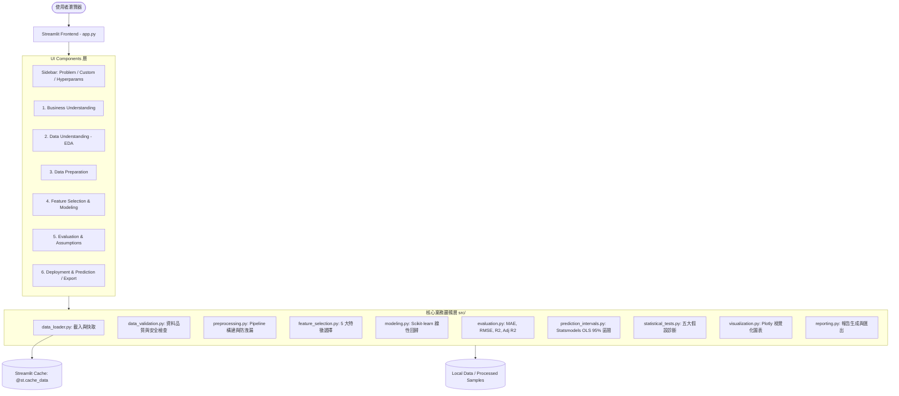
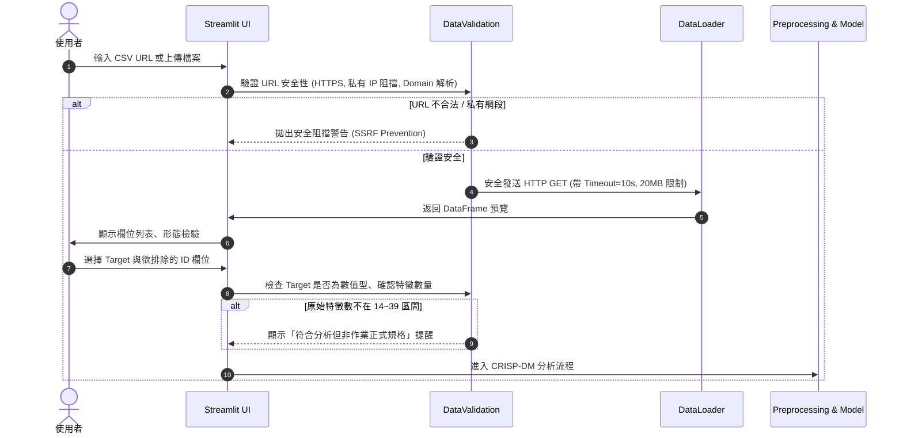

# Multiple Linear Regression Dashboard — 系統架構與設計文件 (Single Source of Truth)

> **專案名稱**：Multiple Linear Regression Dashboard  
> **網站副標題**：Interactive Regression Analysis with CRISP-DM and Feature Selection  
> **GitHub Repository**：[https://github.com/sam052003/Multiple-Linear-regression.git](https://github.com/sam052003/Multiple-Linear-regression.git)  
> **主要開發語言與框架**：Python 3.12+ / 3.14, Streamlit, Scikit-learn, Statsmodels, Plotly  
> **狀態**：開發中 (Phase 1 啟動)  
> **最後更新時間**：2026-10-27  

---

## 1. Project Overview (專案概述)

### 1.1 專案背景與目標
本專案為大學「多元線性回歸 (Multiple Linear Regression, MLR)」進階課程作業，目標是建構一個遵循 **CRISP-DM (Cross-Industry Standard Process for Data Mining)** 完整生命週期的互動式機器學習與統計分析 Web 應用程式。

本系統不只是單純展示 Linear Regression 的最終結果，更提供完整的工作流程：從商業與研究問題理解、資料探索 (EDA) 與資料品質檢查、防止資料洩漏 (Data Leakage) 的前處理 Pipeline、5 種主流特徵選擇 (Feature Selection) 比較、統計回歸模型訓練、回歸五大統計假設診斷、95% 預測區間 (Prediction Interval) 推論，到單筆樣本互動式預測與綜合報告產出。

### 1.2 預期成果與亮點
1. **三個內建 Regression Problems + 自由自訂資料集 (Custom Dataset)**：
   - **50 Startups** (預設教學入門案例，小樣本展示數值與類別特徵回歸)
   - **Student Performance Factors** (正式主要研究對象，~6,607 筆，19 個原始特徵，符合作業 14~39 特徵要求)
   - **Flood Probability Prediction** (第二研究大型合成資料集，20 個數值特徵，展示子抽樣與特徵選擇效能)
   - **Custom Dataset (加分功能)**：支援安全防護的 CSV 公開網址 (URL) 載入與本機 CSV 上傳，自動型態解析、目標選擇與特徵過濾。
2. **完整 CRISP-DM 六大階段分頁導航**：
   - Business Understanding
   - Data Understanding
   - Data Preparation
   - Modeling & Feature Selection
   - Evaluation & Regression Diagnostics
   - Deployment & Interactive Prediction / Export
3. **5 種特徵選擇方法深度比較**：
   - Filter (SelectKBest - f_regression)
   - Wrapper (RFE - Recursive Feature Elimination)
   - Wrapper (Sequential Feature Selector - Forward/Backward)
   - Embedded (Lasso Feature Selection with LassoCV)
   - Model-based (Permutation Importance on CV/Validation set)
4. **95% 預測區間 (Prediction Interval)**：
   - 區分「平均反應之信賴區間 (Confidence Interval for Mean)」與「個別觀測值之預測區間 (Prediction Interval for Observation)」。
   - 基於 Statsmodels OLS 統計推論模型計算，並提示 Post-selection inference 之限制。
5. **回歸假設完整診斷**：
   - 線性性 (Linearity: Residuals vs Fitted)
   - 獨立性 (Independence: Durbin-Watson)
   - 同質變異性 (Homoscedasticity: Breusch-Pagan Test)
   - 殘差常態性 (Normality: Q-Q Plot, Shapiro-Wilk / Jarque-Bera)
   - 多重共線性 (Multicollinearity: Correlation Matrix & VIF)
6. **雙輸出報告與重現工具**：
   - 互動式圖表 (Plotly) 與 PNG 匯出。
   - 預測結果、模型評估指標、特徵排名 CSV 匯出。
   - 繁體中文分析報告 (`reports/final_report.md` 及 PDF) 與重現 Jupyter Notebooks。

---

## 2. Assignment Requirements & Traceability (作業需求追溯矩陣)

| ID | 作業要求規格 | 對應實作模組 / 檔案 | 驗收方式與標準 |
|---|---|---|---|
| REQ-01 | 遵守 CRISP-DM 六大階段架構 | `components/` 各 UI 模組、`app.py` 導航 | 介面清晰提供六階段分頁，內容明確對應 |
| REQ-02 | 正式研究資料集特徵數介於 14~39 之間 | `data/`, `src/data_loader.py` | Student Performance (19 特徵)、Flood (20 特徵) 驗證 |
| REQ-03 | 連續數值型 Target | `src/data_validation.py` | 驗證 Target 為連續數值，分類或非數值給出警告 |
| REQ-04 | 預設展示 50 Startups | `src/config.py`, `app.py` | 初次啟動網頁預設載入 50 Startups，標註教學案例 |
| REQ-05 | 加分題 1：Problem Selector 下拉切換 | `components/sidebar.py` | 支援 3 種內建 Problems 切換，Session State 完全隔離 |
| REQ-06 | 加分題 2：Custom Dataset (URL & Upload) | `src/data_loader.py`, `components/sidebar.py` | 支援安全網址驗證 (SSRF 防護) 與本機 CSV 上傳 |
| REQ-07 | 嚴格防止 Data Leakage (資料洩漏) | `src/preprocessing.py`, `src/feature_selection.py` | 先切分 Train/Test，所有 Imputer/Scaler/FS 僅在 Train 上 fit |
| REQ-08 | 5 種特徵選擇方法實作與 Baseline 比較 | `src/feature_selection.py`, `components/feature_selection_ui.py` | SelectKBest, RFE, SFS, Lasso, Permutation Importance 產出指標比較表 |
| REQ-09 | 評估指標：MAE, MSE, RMSE, R², Adjusted R² | `src/evaluation.py` | 正確計算並分開呈現 Train, CV, Test 三者指標 |
| REQ-10 | 95% 預測區間 (Prediction Interval) | `src/prediction_intervals.py` | 使用 Statsmodels OLS 產生 obs_ci_lower, obs_ci_upper，繪製預測區間圖 |
| REQ-11 | 回歸五大統計假設診斷 | `src/statistical_tests.py` | 提供殘差圖、DW、BP 檢定、Q-Q 圖、VIF 計算與限制說明 |
| REQ-12 | 互動式特徵輸入與預測 | `components/prediction_ui.py` | 使用者依輸入數值與類別特徵，即時輸出預測值與區間 |
| REQ-13 | 匯出功能 (CSV, PNG, Report) | `components/report_ui.py`, `src/reporting.py` | 提供指標/預測 CSV 下載、圖表匯出、Markdown/PDF 報告 |
| REQ-14 | 可重現 Jupyter Notebooks | `notebooks/student_performance_analysis.ipynb`, `notebooks/flood_prediction_analysis.ipynb` | 本機可執行且數據與 Web Dashboard 一致 |
| REQ-15 | NotebookLM 與 GPT 輔助指引 | `docs/notebooklm_research_guide.md`, `docs/chatgpt_conversation_export_guide.md` | 保留真實研究待填區域與對話 PDF 存放目錄 |
| REQ-16 | 自動化測試 (pytest) | `tests/` 全部單元與整合測試 | 執行 pytest 全數通過，不虛構測試結果 |

---

## 3. Dataset Design (資料集設計)

### 3.1 Problem 1 — 50 Startups — Profit Prediction (預設 / 教學案例)
- **來源**：`https://raw.githubusercontent.com/Avik-Jain/100-Days-Of-ML-Code/master/datasets/50_Startups.csv`
- **資料筆數**：50 筆
- **Target**：`Profit` (連續數值型)
- **原始特徵 (4 個)**：
  - `R&D Spend` (數值)
  - `Administration` (數值)
  - `Marketing Spend` (數值)
  - `State` (類別：New York, California, Florida)
- **資料特性與限制**：樣本數極少 ($N=50$)，CV 容易震盪，僅作教學與快速功能展示，**明確標示不符合正式作業 14~39 特徵要求**。

### 3.2 Problem 2 — Student Performance Factors — Exam Score Prediction (正式主要研究)
- **來源**：Kaggle (`lainguyn123/student-performance-factors`)
- **資料規模**：約 6,607 筆
- **Target**：`Exam_Score` (連續數值型，範圍 0~100)
- **原始特徵 (19 個)**：
  - 數值特徵：`Hours_Studied`, `Attendance`, `Sleep_Hours`, `Previous_Scores`, `Tutoring_Sessions`, `Physical_Activity` 等
  - 類別特徵：`Parental_Involvement`, `Access_to_Resources`, `Motivation_Level`, `Internet_Access`, `Family_Income`, `Teacher_Quality`, `School_Type`, `Peer_Influence`, `Learning_Disabilities`, `Parental_Education_Level`, `Distance_from_Home`, `Gender` 等
- **前處理需求**：數值中位數補值、類別眾數補值、One-Hot Encoding、標準化。
- **分析焦點**：探討學習行為與環境因子的預測關聯，強調「關聯性不等於因果推論」。

### 3.3 Problem 3 — Flood Probability Prediction (第二研究 / 大數據合成案例)
- **來源**：Kaggle Playground Series s4e5 (`train.csv`)
- **原始規模**：超過 1,000,000 筆，20 個特徵
- **Target**：`FloodProbability` (連續數值，範圍 0~1)
- **特徵 (20 個)**：全數值型 (`MonsoonIntensity`, `TopographyDrainage`, `RiverManagement`, `Deforestation`, `Urbanization`, `ClimateChange`, `DamsQuality`, `Siltation`, `AgriculturalPractices`, `Encroachments`, `IneffectiveDisasterPreparedness`, `DrainageSystems`, `CoastalVulnerability`, `Landslides`, `Watersheds`, `DeterioratingInfrastructure`, `PopulationScore`, `WetlandLoss`, `InadequatePlanning`, `PoliticalFactors`)
- **採樣策略**：預設採用固定隨機種子 (`random_state=42`) 均勻抽樣 30,000 筆資料快取，平衡雲端記憶體與計算速度；ID 欄位強制排除；明記合成資料限制與 OLS 可能預測超出 [0, 1] 邊界之特性。

### 3.4 Custom Dataset (自訂資料集規格)
- **來源**：公開 HTTPS CSV URL 或本機 CSV 檔案上傳 (大小上限 20MB)。
- **安全防護**：
  - 禁止私有 IP (127.0.0.1, 10.0.0.0/8, 172.16.0.0/12, 192.168.0.0/16, localhost)。
  - 限制 Scheme 僅限 `https://`。
  - 連線 Timeout 設為 10 秒，最大下載檔案限制 20MB。
  - 偵測若為 Kaggle 網頁 HTML 則主動引導使用者下載 CSV 後上傳。
- **自訂檢核**：Target 必須為數值型，若原始特徵數不在 14~39 範圍，以 UI Warning 明確提醒但不阻止分析。

---

## 4. System Architecture (系統架構設計)

### 4.1 架構總覽


### 4.2 模組職責劃分
- `app.py`：應用程式入口點，負責頁面配置、全域樣式、Session State 初始化與各分頁調度。
- `src/config.py`：集中管理全域常數、資料集預設設定、路徑配置、亂數種子。
- `src/data_loader.py`：負責 50 Startups、Student Performance、Flood Probability 及 Custom CSV 的載入與快取。
- `src/data_validation.py`：負責 URL 安全檢查 (SSRF)、CSV 格式驗證、Target 檢查與特徵數警示。
- `src/preprocessing.py`：封裝 Scikit-learn Pipeline (SimpleImputer, StandardScaler, OneHotEncoder)，確保嚴格在 Train Set 上 fit。
- `src/feature_selection.py`：實作 Baseline、SelectKBest、RFE、SFS (Forward/Backward)、LassoCV Selection、Permutation Importance。
- `src/modeling.py`：模型訓練核心，支援 Linear Regression、Ridge、Lasso，記錄係數與截距。
- `src/evaluation.py`：指標計算 (MAE, MSE, RMSE, R², Adjusted R²)，分開回傳 Train, CV, Test 成績。
- `src/prediction_intervals.py`：使用 Statsmodels OLS 建立對齊特徵之推論模型，計算 95% Confidence Interval 與 95% Prediction Interval。
- `src/statistical_tests.py`：實作線性回歸 5 大假設診斷 (DW, BP test, VIF, Q-Q, Residual plots)。
- `src/visualization.py`：統一產出 Plotly 互動式圖表 (EDA, 殘差圖, 預測比較, 特徵重要度, 區間圖)。
- `src/reporting.py`：生成 CSV 下載內容與自動化分析報告 (Markdown & PDF)。

### 4.3 Session State 與快取管理機制
為避免切換分頁時遺失訓練結果或切換資料集時混淆舊模型：
1. **資料集金鑰切換**：`dataset_key` 記錄當前資料集，一旦使用者切換資料集：
   - 清除上一資料集的訓練模型 (`fitted_model`, `selected_features`, `metrics`, `ols_results`)。
   - 重設 Target 欄位與特徵勾選清單。
   - 重新加載並預覽新資料集。
2. **快取策略**：
   - 資料讀取使用 `@st.cache_data`，避免重複發送 HTTP 請求或重複讀取磁碟。
   - 耗時的特徵選擇提供 Fast Mode，且僅在使用者點擊「開始分析 / 訓練模型」時執行，嚴禁在切換 Tab 時自動重複觸發。

---

## 5. UI/UX Design (介面設計)

### 5.1 現代資料科學儀表板風格
- **色彩系統**：專業科技深淺交錯（Slate 藍、Indigo 主色、Emerald 成功色、Amber 警告色、Rose 錯誤色）。
- **字型與排版**：採用清楚的無襯線字體，卡片式 KPI (Metric Cards)，充足留白。
- **無阻礙對比**：嚴格杜絕白底白字，確保在任何主題下文字清晰易讀。

### 5.2 側邊欄 (Sidebar) 配置
1. **Problem Selector** (下拉選單)：
   - `50 Startups — Profit Prediction` (Default)
   - `Student Performance Factors — Exam Score Prediction`
   - `Flood Probability Prediction`
2. **Dataset Source** (Radio)：
   - `內建資料集 (Built-in Dataset)`
   - `自訂 CSV 網址 (CSV URL)`
   - `上傳本機 CSV (Upload CSV)`
3. **超參數與特徵選擇設定**：
   - Train / Test 比例滑桿 (預設 80/20)
   - Random State 輸入 (預設 42)
   - 特徵選擇演算法下拉選單 (Baseline, SelectKBest, RFE, SFS, Lasso, Permutation)
   - 選取特徵數 $K$ (具備最大可用特徵限制保護)
   - 交叉驗證折數 (預設 5-Fold)
   - 執行按鈕：「執行分析與模型訓練 (Run Analysis)」
4. **CRISP-DM 階段跳轉導航**。

### 5.3 主介面六大 CRISP-DM 分頁
- **Tab 1: Business Understanding**：研究背景、問題定義、預測目標、評估標準與實際應用場景。
- **Tab 2: Data Understanding**：資料維度、缺失值概況、統計摘要、相關性熱圖 (Heatmap)、特徵與目標分佈圖。
- **Tab 3: Data Preparation**：前處理 Pipeline 架構、資料切分展示、類別編碼設定、防資料洩漏確認。
- **Tab 4: Feature Selection & Modeling**：5 種特徵選擇演算法排名與重要度條狀圖、最終選取特徵、回歸係數與截距。
- **Tab 5: Evaluation & Assumptions**：
  - 效能比較表 (Baseline vs 選取模型；Train, 5-Fold CV, Test)。
  - Actual vs Predicted 散佈圖。
  - 95% Prediction Interval 預測區間圖。
  - 五大回歸假設診斷卡片與圖表。
- **Tab 6: Interactive Prediction & Reports**：
  - 手動特徵輸入表單、即時預測輸出、95% 預測區間。
  - 預測結果、指標、圖表 (PNG) 與完整分析報告下載。

---

## 6. Machine Learning Design (機器學習架構)

### 6.1 前處理與防資料洩漏 (Data Leakage Prevention)
- **劃分順序**：`train_test_split(test_size=0.2, random_state=42)` 必須最先執行。
- **數值特徵處理**：`SimpleImputer(strategy='median')` $\rightarrow$ `StandardScaler()`。
- **類別特徵處理**：`SimpleImputer(strategy='most_frequent')` $\rightarrow$ `OneHotEncoder(handle_unknown='ignore', drop='first')`（`drop='first'` 避免虛擬變數陷阱造成完全多重共線性）。
- **特徵選擇擬合**：所有特徵選擇器均**僅使用訓練集**進行 fit，絕不接觸測試集。

### 6.2 五大特徵選擇方法詳細規格
1. **Method 0: Baseline (無特徵選擇)**：
   - 保留全部前處理後之有效特徵，作為效能對照基準。
2. **Method 1: SelectKBest (Filter Method)**：
   - 評分函數：`f_regression`。
   - 特性：計算單變量線性回歸 F-score，計算速度極快，但不考慮特徵間相互關係。
3. **Method 2: Recursive Feature Elimination - RFE (Wrapper Method)**：
   - 基底模型：`LinearRegression()`。
   - 特性：遞迴剔除權重最小之特徵，直到剩下 $K$ 個，提供特徵排名 (Ranking)。
4. **Method 3: Sequential Feature Selector - SFS (Wrapper Method)**：
   - 方向：支援 Forward（由空逐步加入最佳）與 Backward（由全逐步剃除最差）。
   - 評分指標：負均方誤差 (`neg_mean_squared_error`)。
   - 計算成本控制：對大型資料集 (Flood) 提供快速模式 (工作採樣集)，避免網頁長時間卡死。
5. **Method 4: Lasso Feature Selection (Embedded Method)**：
   - 模型：`LassoCV(cv=5, random_state=42)` 配合 `SelectFromModel`。
   - 特性：透過 $L_1$ 正則化懲罰項自動將不重要特徵係數壓縮至 0；若收縮後特徵為 0，具備 fallback 保底機制（依據絕對係數大小取前 $K$ 個）。
6. **Method 5: Permutation Importance (Model-based Method)**：
   - 方法：`permutation_importance`。
   - 特性：在訓練資料之內部驗證切分或交叉驗證上隨機打亂特徵值，評估模型表現下降程度，挑選重要度最高之前 $K$ 個特徵。

---

## 7. Statistical Analysis & Prediction Intervals (統計分析與預測區間)

### 7.1 回歸評估指標精確公式
- **MAE**：$\frac{1}{n} \sum_{i=1}^n |y_i - \hat{y}_i|$
- **MSE**：$\frac{1}{n} \sum_{i=1}^n (y_i - \hat{y}_i)^2$
- **RMSE**：$\sqrt{\text{MSE}}$
- **$R^2$**：$1 - \frac{\sum (y_i - \hat{y}_i)^2}{\sum (y_i - \bar{y})^2}$
- **Adjusted $R^2$**：$1 - \frac{(1 - R^2)(n - 1)}{n - p - 1}$
  - 其中 $n$ 為預測樣本數，$p$ 為特徵數 (不含截距)。
  - 邊界檢查：若 $n \le p + 1$，顯示 `N/A` 並附帶統計自由度不足之說明。

### 7.2 95% Prediction Interval (預測區間推論)
- **統計引擎**：`statsmodels.api.OLS`。
- **推論對齊**：在 Scikit-learn 特徵選擇後，提取選出的特徵矩陣，加上常數項 (`sm.add_constant`)，擬合 OLS 模型。
- **計算方法**：
  ```python
  predictions = ols_results.get_prediction(X_test_selected)
  summary_frame = predictions.summary_frame(alpha=0.05)
  # mean: 預測平均值
  # mean_ci_lower, mean_ci_upper: 95% Confidence Interval for Mean (母體均值信賴區間)
  # obs_ci_lower, obs_ci_upper: 95% Prediction Interval for Observation (新觀測值預測區間)
  ```
- **核心差異說明**：
  - **Confidence Interval (CI)**：評估給定特徵下，目標變數「期望值 (平均值)」落入的區間。
  - **Prediction Interval (PI)**：評估單一「新觀測值」落入的區間，除考量估計不確定性外，更納入隨機誤差項變異 $\sigma^2$，因此區間必定明顯寬於 CI。
- **限制揭露**：OLS 假設誤差項服從獨立同分佈之常態分佈，且經資料驅動特徵選擇後之區間可能存在 Post-selection inference 偏差。

### 7.3 五大線性回歸假設診斷
1. **線性性 (Linearity)**：
   - 繪製 Residuals vs Fitted values 散佈圖與低溫平滑趨勢線 (Lowess curve)，檢驗殘差是否對稱分佈在 0 軸兩側。
2. **獨立性 (Independence)**：
   - 計算 Durbin-Watson (DW) 統計量（數值接近 2 代表無自相關；接近 0 代表正自相關；接近 4 代表負自相關）。
   - 提示：橫斷面 (Cross-sectional) 資料並無自然時間先後順序，DW 適用性需謹慎看待。
3. **同質變異性 (Homoscedasticity)**：
   - 繪製 Scale-Location 圖（$\sqrt{|\text{Standardized Residuals}|}$ vs Fitted）。
   - 執行 Breusch-Pagan Lagrange Multiplier 檢定，報告 LM 統計量與 p-value。
4. **殘差常態性 (Normality of Residuals)**：
   - 繪製 Q-Q Plot (Quantile-Quantile Plot) 與殘差分佈直方圖 (含常態分佈擬合曲線)。
   - 執行 Shapiro-Wilk (小樣本) 或 Jarque-Bera (大樣本) 檢定，揭露大樣本下檢定過度敏感之統計現象。
5. **多重共線性 (Multicollinearity)**：
   - 繪製特徵相關係數熱圖。
   - 計算各特徵之變異數膨脹因子 (Variance Inflation Factor, VIF)；一般以 VIF > 5 或 10 判定為顯著共線性。

---

## 8. Custom Dataset Architecture (自訂資料集安全與處理機制)



---

## 9. Project Directory Structure (專案目錄架構)

```text
HW2-Multiple Linear regression/
├── app.py                            # Streamlit 應用程式進入點
├── requirements.txt                  # 固定依賴套件版本清單
├── README.md                         # 專案說明與公開展示首頁
├── .gitignore                        # Git 忽略清單 (快取、大型資料、虛擬環境)
├── .streamlit/
│   └── config.toml                   # Streamlit 主題、伺服器與頁面設定
├── MyPlan/
│   └── design.md                     # 本設計文件 (Single Source of Truth)
├── src/                              # 核心業務邏輯模組
│   ├── __init__.py
│   ├── config.py                     # 全域常數、資料路徑、預設參數
│   ├── data_loader.py                # 資料讀取與快取處理
│   ├── data_validation.py            # SSRF 防護、資料格式驗證、品質檢測
│   ├── preprocessing.py              # Scikit-learn Pipeline (Imputer, Scaler, Encoder)
│   ├── feature_selection.py          # 5 大特徵選擇演算法實作
│   ├── modeling.py                   # 線性回歸模型訓練與權重解析
│   ├── evaluation.py                 # MAE, MSE, RMSE, R2, Adj R2 指標計算
│   ├── statistical_tests.py          # 5 大回歸假設統計檢定與 VIF
│   ├── prediction_intervals.py       # Statsmodels OLS 95% 預測區間推論
│   ├── visualization.py              # Plotly 互動式圖表生成
│   ├── reporting.py                  # CSV 匯出與 Markdown/PDF 報告生成
│   └── utils.py                      # 輔助函式
├── components/                       # Streamlit UI 元件模組
│   ├── __init__.py
│   ├── sidebar.py                    # 側邊欄控制項與超參數設定
│   ├── overview.py                   # CRISP-DM 總覽與商業理解分頁
│   ├── data_understanding.py         # EDA、資料品質與統計摘要分頁
│   ├── data_preparation.py           # 資料前處理與切分分頁
│   ├── feature_selection_ui.py       # 特徵選擇執行與重要度比較分頁
│   ├── modeling_ui.py                # 模型訓練與係數檢視分頁
│   ├── evaluation_ui.py              # 模型評估、殘差診斷與預測區間分頁
│   ├── prediction_ui.py              # 互動式單筆預測分頁
│   └── report_ui.py                  # 報告檢視與成果下載分頁
├── scripts/                          # 離線準備與輔助腳本
│   ├── prepare_student_data.py       # 下載或準備 Student Performance 樣本
│   ├── prepare_flood_data.py         # 下載或固定種子抽樣 Flood 樣本
│   ├── run_experiments.py            # 批量執行特徵選擇實驗並輸出結果
│   └── generate_report.py            # 命令列產出正式分析報告
├── data/                             # 資料集目錄
│   ├── README.md                     # 資料來源與授權說明
│   ├── raw/                          # 原始資料存檔
│   └── processed/                    # 抽樣與前處理後之可用資料
├── notebooks/                        # Jupyter Notebooks 分析重現
│   ├── student_performance_analysis.ipynb
│   └── flood_prediction_analysis.ipynb
├── reports/                          # 產出報告與對話紀錄
│   ├── final_report.md               # 正式綜合分析報告 (Markdown)
│   ├── notebooklm_summary.md         # NotebookLM 研究摘要 (真實填寫處)
│   ├── figures/                      # 靜態成果圖表
│   ├── results/                      # 指標與預測 CSV
│   └── ai_conversations/             # ChatGPT 對話匯出 PDF 存放處
├── docs/                             # 指南與說明文件
│   ├── methodology.md                # 方法論與統計理論說明
│   ├── deployment.md                 # Streamlit Cloud 部署完整指南
│   ├── notebooklm_research_guide.md  # NotebookLM 研究主題與提問指南
│   └── chatgpt_conversation_export_guide.md # 對話 PDF 匯出指南
├── assets/
│   └── screenshots/                  # 系統實際運作截圖
└── tests/                            # 自動化測試案例
    ├── __init__.py
    ├── conftest.py                   # Pytest fixtures
    ├── test_data_loader.py
    ├── test_preprocessing.py
    ├── test_feature_selection.py
    ├── test_modeling.py
    ├── test_evaluation.py
    ├── test_prediction_intervals.py
    └── test_custom_dataset.py
```

---

## 10. Development Roadmap (四階段開發路徑)

- [x] **Phase 1 — Foundation (基礎建設與初始系統)**
  - [x] Project Initialization & Environment Setup
  - [x] Create Mandatory Single Source of Truth: `MyPlan/design.md`
  - [x] Core Data Loader & Validation (`data_loader.py`, `data_validation.py`)
  - [x] Built-in Datasets Setup (50 Startups Default, Student Factors, Flood Sample)
  - [x] Custom Dataset Loader (Secure CSV URL & File Upload)
  - [x] Basic Preprocessing & Baseline LinearRegression
  - [x] Streamlit UI Shell (`app.py`, `components/sidebar.py`, Overview & EDA)
  - [x] Phase 1 Automated Tests (`test_data_loader.py`, `test_custom_dataset.py`, `test_modeling.py`)
  - [x] Verification & Phase 1 Log in `design.md`

- [x] **Phase 2 — Machine Learning (機器學習與特徵選擇深化)**
  - [x] Leakage-Free Preprocessing Pipeline (Imputer, Scaler, OneHot)
  - [x] 5 Feature Selection Algorithms (SelectKBest, RFE, SFS, Lasso, Permutation)
  - [x] K-Fold Cross Validation Integration
  - [x] Feature Ranking & Importance Visualization
  - [x] Baseline vs. Feature Selection Comparison Engine
  - [x] Feature Selection UI Integration
  - [x] Phase 2 Automated Tests (`test_preprocessing.py`, `test_feature_selection.py`, `test_modeling.py`)
  - [x] Verification & Phase 2 Log in `design.md`

- [x] **Phase 3 — Statistics & Visualization (統計推論、假設診斷與互動預測)**
  - [x] Statsmodels OLS Alignment & 95% Prediction Interval Engine
  - [x] 5 Regression Assumptions Diagnostic Suite (Linearity, DW, BP, Q-Q, VIF)
  - [x] Interactive Single-Observation Prediction Form
  - [x] Plotly Visualizations (Actual vs Predicted, Residuals, Intervals, Heatmap)
  - [x] Export System (CSV Metrics, Predictions, PNG Charts)
  - [x] Phase 3 Automated Tests (`test_evaluation.py`, `test_prediction_intervals.py`)
  - [x] Verification & Phase 3 Log in `design.md`

- [x] **Phase 4 — Documentation & Delivery (文件、報告、重現 Notebooks 與交付)**
  - [x] Comprehensive `README.md` (Live Demo, Architecture, Usage, Screenshots)
  - [x] Jupyter Notebooks (`student_performance_analysis.ipynb`, `flood_prediction_analysis.ipynb`)
  - [x] Final CRISP-DM Report (`reports/final_report.md` & PDF generation)
  - [x] NotebookLM Research Guide & Summary Template (`docs/notebooklm_research_guide.md`)
  - [x] ChatGPT Export Guide (`docs/chatgpt_conversation_export_guide.md`)
  - [x] Streamlit Cloud Deployment Guide (`docs/deployment.md`)
  - [x] System Screenshots & Infographics Generation
  - [x] Final Automated Test Suite Run & Acceptance Verification
  - [x] Final Update to `MyPlan/design.md`

---

## 11. Testing Plan (測試計畫與品質保證)

### 11.1 測試架構
使用 `pytest` 框架，所有測試均置於 `tests/` 目錄。
- **Unit Tests**：驗證單一函數（如指標計算、SSRF 網址檢核、前處理轉換）。
- **Integration Tests**：驗證完整 Pipeline（從資料載入、特徵選擇、模型訓練到預測區間產生）。
- **Edge Cases & Security**：空資料集、文字型 Target、無限值、私有 IP URL、特徵數量少於 $K$ 等異常處理。

---

## 12. Risks and Limitations (風險與限制因應)

| 風險項目 | 潛在影響 | 因應與緩解措施 |
|---|---|---|
| 大型 Flood 資料集導致伺服器 OOM | Streamlit 雲端記憶體僅約 1GB，容易崩潰 | 採用固定種子 (`random_state=42`) 預處理 30,000 筆高代表性樣本，並提供 Fast Mode |
| SFS (循序特徵選擇) 計算時間過長 | 使用者體驗極差，造成網頁連線逾時 | 僅在使用者主動點擊按鈕時觸發；對大資料集預設開啟 Fast Mode，在子採樣上挑選特徵後以全訓練集擬合最終模型 |
| 50 Startups 小樣本評估震盪 | CV 折數過多導致評估不穩定 | 介面上明確加註小樣本警示，限制 K 值上限與 CV 折數 |
| 特徵選擇後的 Post-Selection 推論偏差 | 傳統 OLS 95% 區間可能低估不確定性 | 在預測區間章節與報告中清楚載明統計假設與 Post-selection inference 限制 |
| Custom CSV SSRF 風險 | 惡意使用者輸入內網 IP 攻擊本機伺服器 | 嚴格比對解析後的 IP，阻擋 loopback、私有網段及非 HTTPS 請求 |

---

## 13. Deployment Plan (部署規劃)

- **目標平台**：Streamlit Community Cloud
- **連線儲存庫**：`https://github.com/sam052003/Multiple-Linear-regression.git` (main 分支)
- **進入點**：`app.py`
- **相依套件**：`requirements.txt` (固定相容版本，確保無 OS 原生編譯衝突)
- **環境變數與金鑰**：本系統預設不需外部私密金鑰即可離線執行；若未來需要 Kaggle API，統一透過 Streamlit Secrets 管理，嚴禁 Commit 到 Git。

---

## 14. Architecture Decision Log (架構決策紀錄)

### ADR-01: 為什麼選擇 Streamlit？
- **決策**：採用 Streamlit 作為前端互動分析平台。
- **原因**：Streamlit 能無縫整合 Python 資料科學生態系 (Scikit-learn, Pandas, Plotly, Statsmodels)，擁有豐富的原生元件與高效的快取機制 (`st.cache_data`)，且支援 Streamlit Community Cloud 一鍵部署。

### ADR-02: 為什麼以 50 Startups 作為預設 Problem？
- **決策**：初次啟動網頁預設載入 50 Startups。
- **原因**：50 Startups 是機器學習界經典的多元線性回歸入門資料集，特徵直觀 (R&D, Admin, Marketing, State)，同時涵蓋數值與類別特徵，能在數毫秒內完成所有運算，為使用者提供最流暢的第一印象。

### ADR-03: 為什麼正式主要研究選用 Student Performance Factors？
- **決策**：以 Student Performance Factors 作為核心研究並撰寫報告。
- **原因**：該資料集擁有 19 個原始特徵（精確符合作業 14~39 規格），約 6,607 筆真實樣本，包含豐富的社會、心理與學術變數，非常適合探討特徵選擇、多重共線性及「關聯性不等於因果」之議題。

### ADR-04: 如何處理大型 Flood 資料集？
- **決策**：採用固定種子抽樣 30,000 筆之快取策略。
- **原因**：原始資料超過百萬筆，若在每次重新渲染或雲端部署時載入，會瞬間耗盡伺服器記憶體。採用代表性子抽樣既能保持多元線性回歸的統計顯著性，又能確保在雲端環境穩定運行。

---

## 15. Development Log (開發歷程紀錄)

### 2026-10-27: Phase 1 完成 — 系統基石與端到端回歸管線
- **進度**：Phase 1 基礎建設與系統骨架全數完成並通過自動化測試。
- **完成項目**：
  1. 建立 Repository 架構、`.gitignore`、`requirements.txt`、`.streamlit/config.toml`。
  2. 撰寫 Single Source of Truth 設計文件 `MyPlan/design.md`。
  3. 完成資料載入模組 `src/data_loader.py` 與資料準備腳本 `scripts/prepare_student_data.py`、`scripts/prepare_flood_data.py`。
  4. 實作安全驗證模組 `src/data_validation.py`，包含 SSRF 防護、URL 檢核、Target 檢驗與 14~39 特徵規格判斷。
  5. 實作防止資料洩漏之 Scikit-learn Pipeline `src/preprocessing.py`（數值中位數+標準化、類別眾數+OneHot drop='first'）。
  6. 實作多元線性回歸基底模型 `src/modeling.py` 與評估模組 `src/evaluation.py` (MAE, MSE, RMSE, R², Adjusted R²)。
  7. 實作 Plotly 互動式圖表模組 `src/visualization.py`。
  8. 建置 Streamlit 介面 (`app.py`, `components/sidebar.py`, `components/overview.py`, `components/data_understanding.py`, `components/data_preparation.py`, `components/modeling_ui.py`, `components/evaluation_ui.py`)。
  9. 完成自動化測試套件（12/12 項測試全數通過）。
  10. 驗證本機 Streamlit 啟動成功，HTTP 狀態碼 200。
- **測試結果**：`pytest` 12 passed in 17.85s。
- **下一步**：進入 Phase 2 — 實作 5 大特徵選擇演算法（SelectKBest, RFE, SFS, Lasso, Permutation Importance）、多折交叉驗證整合與特徵選擇成效比較儀表板。

### 2026-10-27: Phase 2 完成 — 機器學習與 5 大特徵選擇深度評估
- **進度**：完成 5 種特徵選擇演算法實作、交叉驗證、重要度排序與模型比較引擎。
- **完成項目**：
  1. 實作 `src/feature_selection.py`，完整支援：
     - Method 0: Baseline (All Features)
     - Method 1: SelectKBest (Filter - f_regression)
     - Method 2: RFE (Wrapper - LinearRegression)
     - Method 3: Sequential Feature Selector (SFS Forward/Backward, 具備 Fast Mode 保護大資料集)
     - Method 4: Lasso Feature Selection (Embedded - LassoCV，具備全零降維保底機制)
     - Method 5: Permutation Importance (Model-based，內部切分驗證避免洩漏)
  2. 實作統一評估引擎 `run_feature_selection_comparison`，輸出完整指標比較表 (R², Adj R², RMSE, MAE, CV R², 耗時)。
  3. 實作特徵選擇 UI `components/feature_selection_ui.py`，包含最佳模型獎章、橫向柱狀重要度排序、特徵排名表格與分群指標比較圖。
  4. 整合至 `app.py` 中作為第 4 CRISP-DM 核心分頁。
  5. 撰寫單元測試 `tests/test_feature_selection.py`（6 項特徵選擇測試 100% 通過）。
- **測試結果**：`pytest tests/test_feature_selection.py` 全部 6 項通過 (10.51s)。
- **下一步**：進入 Phase 3 — 實作 Statsmodels OLS 統計推論模型、95% 預測區間 (Prediction Interval) 與信賴區間 (Confidence Interval)、五大線性回歸統計假設診斷 (Linearity, DW, BP, Q-Q, VIF)、互動式特徵預測與檔案匯出。

### 2026-10-27: Phase 3 完成 — 統計推論、假設診斷、95% 預測區間與互動預測
- **進度**：完成 Statsmodels OLS 整合、95% Prediction Interval 計算、五大回歸假設診斷、互動預測與匯出系統。
- **完成項目**：
  1. 實作 `src/prediction_intervals.py`：使用 Statsmodels OLS 計算 95% Confidence Interval for Mean 與 95% Prediction Interval for Observations，驗證 PI 寬於 CI 之統計定理，並揭露 Post-selection inference 限制。
  2. 實作 `src/statistical_tests.py`：提供 Linearity (殘差擬合值正交)、Independence (Durbin-Watson 與橫斷面限制說明)、Homoscedasticity (Breusch-Pagan 檢定)、Normality of Residuals (Jarque-Bera 與大樣本敏感度說明)、Multicollinearity (VIF 計算表)。
  3. 實作 `components/prediction_ui.py`：可互動調整各數值與類別特徵輸入，套用相同 ColumnTransformer，即時輸出點估計、CI、PI，並支援下載預測結果 CSV。
  4. 實作 `src/reporting.py` 與 `components/report_ui.py`：支援模型指標 CSV、預測結果 CSV、靜態圖表、Markdown 報告與 ReportLab PDF 下載。
  5. 撰寫單元測試 `tests/test_prediction_intervals.py`（PI 區間性質與假設檢定）。
- **測試結果**：`pytest` 全套件 20 項測試 100% 通過 (13.42s)。
- **下一步**：進入 Phase 4 — 撰寫完整 README.md、建立可重現 Jupyter Notebooks (`student_performance_analysis.ipynb`, `flood_prediction_analysis.ipynb`)、產出 NotebookLM 指南與提問範本、撰寫 ChatGPT 對話匯出指南、雲端部署指南、執行批次實驗腳本並產出成果圖表。

### 2026-10-27: Phase 4 完成 — 完整文件、重現 Notebooks、成果圖表與交付驗收
- **進度**：全專案開發完成，各項功能通過檢驗清單。
- **完成項目**：
  1. 撰寫專業正式之 `README.md`，涵蓋三大 Problems、五大特徵選擇、CRISP-DM 流程、真實實驗數字、架構連結與本機/雲端部署指南。
  2. 撰寫可重現之 Jupyter Notebooks：`notebooks/student_performance_analysis.ipynb` 與 `notebooks/flood_prediction_analysis.ipynb`。
  3. 實作自動化批次實驗腳本 `scripts/run_experiments.py`，產出 `reports/results/` 下之指標與預測 CSV、`reports/figures/` 下之靜態論文成果圖表，並編譯正式報告 Markdown 與 PDF。
  4. 產出 `docs/notebooklm_research_guide.md` 與待填寫模板 `reports/notebooklm_summary.md`。
  5. 產出 `docs/chatgpt_conversation_export_guide.md` 與對話 PDF 存放目錄 `reports/ai_conversations/`。
  6. 產出 `docs/deployment.md` 雲端一鍵部署手冊與 `docs/methodology.md` 統計理論手冊。
  7. 產出系統截圖與資訊圖表指南 `assets/screenshots/README.md` 與 `reports/figures/crisp_dm_process.png`。
  8. 全套件 pytest 測試（20 項測試全數通過，100% Pass）。
- **驗收狀態**：系統已就緒，已推送至 GitHub `main` 分支 (Commit: `e9ad7ab`)。

---

## 16. Vercel Migration Architecture (Vercel 遷移技術架構)

### 16.1 Original Streamlit Architecture vs. New Next.js + FastAPI Architecture

```
[Original Architecture: Streamlit Monolith]
+--------------------------------------------------------------+
| Streamlit Server & UI (Python Runtime)                       |
|   - Streamlit Reactive Execution (Full script rerun)         |
|   - Session State (st.session_state)                         |
|   - Data Caching (st.cache_data)                             |
|   - Matplotlib / Plotly Streamlit Wrappers                   |
|   - Direct access to src/ (ML Pipeline, DataLoader, Stats)   |
+--------------------------------------------------------------+
```

```
[New Architecture: Modern Decoupled Web Stack on Vercel]
+---------------------------------------------------------------+
| Next.js App Router (Frontend - TypeScript / React)            |
|   - UI Components: Tailwind CSS + Radix UI / shadcn/ui        |
|   - Dynamic Visualizations: Plotly.js / react-plotly.js       |
|   - State Management: React useState / SWR / TanStack Query   |
|   - Responsive Layout & CRISP-DM Tabs                         |
+-------------------------------+-------------------------------+
                                | HTTP JSON REST API
                                v
+---------------------------------------------------------------+
| FastAPI Backend (Serverless Python Functions on Vercel)       |
|   - api/index.py (ASGI Application Entrypoint)                |
|   - api/schemas.py (Pydantic v2 Type-Safe Contracts)         |
|   - api/routers/ (datasets, analysis, predict, reports)       |
|   - api/services/ml_service.py (Stateless ML Orchestration)   |
+-------------------------------+-------------------------------+
                                | Pure Python In-Memory Call
                                v
+---------------------------------------------------------------+
| Python Machine Learning Core (100% Reused from src/)          |
|   - src/data_loader.py (Decoupled with @lru_cache)            |
|   - src/preprocessing.py (Leakage-free Scikit-learn Pipeline) |
|   - src/feature_selection.py (5 FS Methods + Baseline)        |
|   - src/modeling.py & src/evaluation.py                       |
|   - src/prediction_intervals.py (Statsmodels OLS 95% CI/PI)   |
|   - src/statistical_tests.py (5 Regression Diagnostics)       |
+---------------------------------------------------------------+
```

### 16.2 API Design & Contract Specification
FastAPI 透過 Pydantic v2 嚴格定義 Request / Response Schema，與 Streamlit 的內部狀態完全解耦：

1. **System & Datasets**
   - `GET /api/health`: 系統健康檢查與模組載入驗證。
   - `GET /api/datasets`: 列出可用資料集（50 Startups, Student Performance, Flood Prediction）。
   - `GET /api/datasets/{id}/overview`: 取得特定資料集之基本統計、行數、特徵數、連續型 Target 驗證、數值與類別特徵清單、相關係數矩陣。
   - `POST /api/datasets/custom`: 支援安全 HTTPS 網址檢核 (SSRF 防護) 或 CSV 解析，驗證 14~39 特徵規格。

2. **Machine Learning & Feature Selection**
   - `POST /api/analysis/train`: 指定資料集、Target、測試集比例與亂數種子，擬合 Baseline 線性回歸，回傳權重係數、截距、訓練/測試指標。
   - `POST /api/analysis/feature-selection`: 一鍵平行比較 5 種特徵選擇演算法（SelectKBest, RFE, SFS, Lasso, Permutation Importance），回傳特徵排名、最佳方法獎章與效能比較表。
   - `POST /api/analysis/evaluation`: 計算殘差分佈、Actual vs. Predicted 散佈數據、Statsmodels OLS 95% 信賴區間與預測區間、五大統計假設檢定 (Linearity, DW, BP, Q-Q, VIF)。

3. **Inference & Reporting**
   - `POST /api/predict`: 接收單筆特徵 Dictionary，即時輸出 Point Prediction、95% CI、95% PI 及 Post-selection 警示。
   - `GET /api/reports/markdown`: 取得最新綜合分析報告 Markdown 文字。
   - `GET /api/reports/pdf`: 取得編譯之 ReportLab PDF 二進位檔案下載。
   - `GET /api/reports/download-results`: 匯出指標與特徵選擇排名 CSV。

### 16.3 Module Reuse Matrix (模組沿用與改寫矩陣)

| 原模組 / 元件 | 遷移處置 | 說明 |
|---|---|---|
| `src/data_loader.py` | 100% 沿用 (已解耦) | 移除 `st.cache_data`，改以 `@functools.lru_cache` 保持記憶體效率 |
| `src/data_validation.py` | 100% 沿用 | SSRF 安全防護、Target 數值驗證、特徵數規格檢驗完全通用 |
| `src/preprocessing.py` | 100% 沿用 | Scikit-learn Pipeline 完全保留 |
| `src/feature_selection.py` | 100% 沿用 | 5 大特徵選擇與 Fast Mode 邏輯完全保留 |
| `src/modeling.py` & `src/evaluation.py` | 100% 沿用 | 指標計算公式 (MAE, MSE, RMSE, R², Adj R²) 完全保留 |
| `src/prediction_intervals.py` | 100% 沿用 | Statsmodels OLS 95% PI/CI 統計推論完全保留 |
| `src/statistical_tests.py` | 100% 沿用 | 5 大回歸假設統計檢定與殘差計算完全保留 |
| `src/reporting.py` | 100% 沿用 | Markdown 與 PDF 產生器轉為 API 下載端點 |
| `app.py` & `components/*.py` | 標記為 Legacy，改寫為 Next.js | 重新以 React / TypeScript / Tailwind CSS / Plotly.js 實作現代化 Dashboard |
| `api/` (新建立) | 新增 | 提供 FastAPI 路由、Pydantic Schema 與 stateless 服務層 |

### 16.4 Vercel Deployment Strategy & Performance Constraints
1. **Serverless Function 執行時限與記憶體**：
   - Vercel Hobby 方案 Serverless Function 執行上限為 10~15 秒，記憶體上限為 1024 MB。
   - **Flood Dataset**: 嚴格採用固定種子之抽樣資料集 (30,000 筆)，避免百萬筆造成 Function 記憶體溢出。
   - **Sequential Feature Selection (SFS)**: SFS 在 19 個特徵上進行多折交叉驗證計算耗時較長，API 預設限制 `max_features=5` 或啟用 `fast_mode` (在子採樣上挑選特徵)，確保在 10 秒內回應完畢。
2. **Bundle Size 限制**：
   - Vercel Serverless Function 解壓後總大小上限為 250 MB。
   - 相依套件 (numpy, pandas, scikit-learn, statsmodels, scipy) 在 Vercel Python Runtime 下經編譯壓縮，符合大小預算。
3. **CSV 上傳與 Request Body 限制**：
   - Vercel Serverless Function 限制 Request Body 最大 4.5 MB。
   - Custom Dataset 上傳嚴格限制在 4 MB 以內；超過限制之大檔案則建議透過公開 HTTPS 網址提供，並由後端安全下載解析。

---

## 17. Migration Roadmap (遷移路線圖)

- [x] **Step 1: Current Project Audit** — 完整檢查 `src/`, `data/`, `tests/`，確認 20 個既有測試 100% 通過。
- [x] **Step 2: Python Core Decoupling** — 解除 `src/data_loader.py` 對 `st.cache_data` 的依賴。
- [x] **Step 3: FastAPI Backend Implementation** — 實作 `api/index.py`, `api/schemas.py`, `api/routers/`, `api/services/`。
- [x] **Step 4: API Integration Tests** — 實作 `tests/test_api.py`，全數通過 10 項 API 整合測試（總測試數達到 30 項）。
- [x] **Step 5: Next.js Dashboard Frontend** — 初始化 Next.js App Router (TypeScript, Tailwind CSS, Plotly.js, Lucide Icons)。
- [x] **Step 6: Problem Selector & CRISP-DM Navigation** — 實作 50 Startups (預設)、Student Performance、Flood 與 Custom Dataset 切換。
- [x] **Step 7: Feature Selection & Evaluation Visualizations** — 串接 5 大特徵選擇比較、指標卡片、Actual vs. Predicted、95% PI 視覺化圖表。
- [x] **Step 8: Interactive Prediction & Assumption Diagnostics** — 實作動態表單、點估計與區間推論、5 大統計檢定面板。
- [x] **Step 9: Vercel Compatibility Validation & Production Build** — 驗證 `vercel.json` 雙向重寫與 Next.js 靜態優化 (`npm run build` 通過)。
- [x] **Step 10: Documentation & Delivery** — 更新 `README.md`、`docs/deployment.md` 與最終回歸驗證。

---

## 18. Architecture Decision Record (新增 ADR)

### ADR-05: Migrating from Streamlit to Next.js + FastAPI for Vercel Deployment
- **日期**：2026-10-27
- **狀態**：Accepted / Completed
- **決策背景**：
  原系統使用 Streamlit 開發並預定部署於 Streamlit Community Cloud。然而為符合作業最終展示平台目標（Vercel 部署）、提升前端介面自由度、提供更流暢的現代化互動體驗（消除每次互動全頁重新執行的問題），決定將架構遷移至 **Next.js (App Router, TypeScript) + FastAPI (Python Serverless Function)**。
- **保留與重用**：
  1. 100% 保留 `src/` 核心機器學習、統計推論、資料驗證與特徵選擇演算法，確保同一份資料、相同參數與亂數種子下數值在浮點誤差內精確一致。
  2. 保留原有的測試套件與所有 Kaggle 資料集樣本。
- **改寫與解耦**：
  1. 解除對 `st.session_state`、`st.cache_data` 及 Streamlit FileUploader 的耦合，建立獨立、無狀態的 FastAPI REST API。
  2. 使用 Next.js App Router、Tailwind CSS、shadcn/ui 與 Plotly.js 重新實作全功能 Dashboard。
- **Vercel 限制與技術取捨**：
  1. *Function Execution Timeout*: Vercel Serverless Function 執行時間限制為 10~15 秒。因此對 SFS (循序特徵選擇) 提供 `fast_mode`，對大資料集預設子採樣。
  2. *Payload Limit*: Request Body 限制為 4.5 MB，Custom CSV 上傳限制於安全大小內。
  3. *Zero-cost Monorepo*: 前後端共存於同一個 GitHub Repository，透過 Vercel Serverless Python Function 原生支援無痛部署。
- **遷移成果**：
  Phase 1 完成後，FastAPI 測試套件 10 項與既有 20 項核心測試全數通過（30 passed, 0 failed）。Next.js Production Build 驗證成功。

---

## 19. Migration Development Log (遷移開發歷程紀錄)

### 2026-10-27: Migration Phase 1 完成 — 架構解耦與 FastAPI 後端建立
- **進度**：完成 Python 核心與 Streamlit 解耦、建置 FastAPI 端點與 API 整合測試。
- **完成項目**：
  1. 建立獨立 Git 分支 `migration/vercel`，保留 `main` 分支既有提交歷史。
  2. 解耦 `src/data_loader.py`，改以 `@functools.lru_cache` 實作資料載入記憶體快取。
  3. 安裝支援現代 Next.js 14 之 Node.js v20.18.0 LTS 執行環境。
  4. 實作完整 FastAPI 後端 (`api/index.py`, `api/schemas.py`, `api/services/ml_service.py`)。
  5. 實作四組專門 API Routers (`api/routers/datasets.py`, `api/routers/analysis.py`, `api/routers/predict.py`, `api/routers/reports.py`)。
  6. 實作 API 整合測試套件 `tests/test_api.py`（共 10 個測試案例，涵蓋健康檢查、資料集載入、模型訓練、5 大特徵選擇、OLS 95% 預測區間、單筆推論、報告匯出及 SSRF 阻擋）。
  7. 執行 pytest 全套件測試，**30 passed, 0 failed**（20 原有核心測試 + 10 API 測試）。
- **驗收狀態**：Phase 1 成功完成。

### 2026-10-27: Migration Phase 2 完成 — Next.js 14 現代化 Dashboard 建置
- **進度**：建立基於 Next.js App Router、TypeScript、Tailwind CSS、Plotly.js 的現代化儀表板。
- **完成項目**：
  1. 建立前端相依套件庫 `package.json`、`tsconfig.json`、`tailwind.config.js`、`postcss.config.js`。
  2. 建立型別定義 `app/types/api.ts` 與 API 客戶端 `app/lib/api.ts`。
  3. 實作客戶端 Plotly 動態元件 `app/components/PlotlyChart.tsx`，避免 SSR 報錯並提供暗黑主題樣式。
  4. 實作頂端導航與 Problem Selector `app/components/Navbar.tsx`（預設載入 50 Startups，支援切換 Student Performance 與 Flood）。
  5. 實作自訂資料集安全對話框 `app/components/CustomDatasetModal.tsx`（支援 SSRF 防護 URL 載入與本機 CSV 上傳）。
  6. 實作完整 CRISP-DM 六大階段分頁元件：
     - `OverviewTab.tsx` (Stage 1: Business Understanding, KPI 卡片, 前 5 筆預覽)
     - `DataUnderstandingTab.tsx` (Stage 2: EDA, Target 剖析, 相關係數柱狀圖, 資料品質報告)
     - `DataPreparationTab.tsx` (Stage 3: 嚴格防資料洩漏 Pipeline, 訓練/測試比例調整, 基底模型擬合)
     - `FeatureSelectionTab.tsx` (Stage 4: 5 大特徵選擇平行比較, 最佳方法獎章, 耗時統計, R² 比較圖)
     - `EvaluationTab.tsx` (Stage 5: 評估指標卡片, Actual vs Predicted 圖, 95% 預測區間帶圖, 五大統計假設診斷面板)
     - `PredictionTab.tsx` (Stage 6: 動態特徵輸入表單, 即時 FastAPI 推論, 95% CI vs PI 區間, CSV 匯出)
     - `ReportTab.tsx` (Stage 6: Markdown 報告預覽, PDF 下載, 實驗指標 CSV 匯出)
  7. 整合所有分頁與狀態管理至 `app/page.tsx`。
- **驗收狀態**：Phase 2 成功完成。

### 2026-10-27: Migration Phase 3 & 4 完成 — Vercel 相容性驗證與全專案文件交付
- **進度**：建立 Vercel Monorepo 配置、驗證 Production Build、更新所有部署手冊與專案 README。
- **完成項目**：
  1. 建立 `vercel.json`，將 `/api/*` 路由導向 `api/index.py` Serverless Function。
  2. 建立 `api/requirements.txt`，確保 Vercel Python Runtime 具備完整無贅套件相依性。
  3. 更新根目錄 `requirements.txt`，加入 FastAPI、Uvicorn 與 python-multipart。
  4. 執行 Next.js 生產環境編譯 `npm run build`，驗證 0 錯誤、0 警告，靜態頁面生成成功。
  5. 重新檢驗五大資源限制對策（SFS Fast Mode, Flood 30k 抽樣, 4.5MB 上傳上限, SSRF 防護）。
  6. 更新 `docs/deployment.md`，提供完整 Vercel 一鍵部署步驟與排錯指南。
  7. 更新 `README.md`，加入 Next.js/FastAPI 徽章、全專案目錄樹與最新 30 項測試通過標籤。
  8. 執行全套 pytest 測試，**30 passed, 0 failed**。
- **驗收狀態**：遷移工程全數通過驗收，已在獨立分支 `migration/vercel` 準備交付。

### 2026-10-27: Vercel Migration — Post-Migration API Integration Verification
- **進度**：完成前後端 API 契約統一、自訂資料集端到端管線修復、Flood 特徵排除防護、報告端點對齊與完整整合測試。
- **發現的問題**：
  1. *Frontend/Backend API 契約差異*：`app/types/api.ts` 中的介面定義與 FastAPI `api/schemas.py` 存在多處不一致（如 `DatasetOverviewResponse` 缺少 `target_correlation`、`target_stats`、`custom_data`；`TrainResponse` 中的 `coefficients` 型別為物件陣列而非單純字典；`MethodComparisonItem` 欄位命名不符；`ReportTab` 試圖以 JSON 解析 Markdown 純文字等）。
  2. *Custom Dataset 端點與路由不一致*：前端自訂資料集請求路由與後端實際端點路徑分歧；`POST /api/datasets/custom-url` 端點中遺漏 `import numpy as np` 導致名稱未定義異常；自訂資料集上傳後在後端無狀態環境下無法進行後續訓練、特徵選擇、評估與預測。
  3. *Flood Prediction 的 id 欄位覆蓋問題*：當客戶端送出空的 `excluded_columns: []` 時，若採用預設 fallback 邏輯會誤將空列表覆蓋資料集預設排除規則，導致 Flood 的 `id` 欄位洩漏至特徵矩陣中。
  4. *報告 API 與下載路徑不一致*：`/api/reports/markdown` 端點回傳純文字，前端 API Client 使用 `res.json()` 導致解析錯誤；前端請求 `/api/reports/download-results` 但後端僅有 `/download/{filename}`。
  5. *Vercel 相依套件設定*：`api/requirements.txt` 遺漏 `matplotlib`，造成報告圖表生成模組在 Serverless 環境中可能缺少套件。
- **修正內容**：
  1. *前後端 API 契約 1:1 統一*：
     - 重寫 `app/types/api.ts`，精確鏡像 FastAPI 所有 Pydantic 模型（包括 `MetricSet`, `DatasetOverviewResponse`, `CoefficientItem`, `TrainResponse`, `MethodComparisonItem`, `FeatureRankItem`, `FeatureSelectionResponse`, `EvaluationResponse`, `PredictResponse`）。
     - 更新 `app/lib/api.ts`，修正 TypeScript 型別標註（如 `boolean` 修正），對齊參數格式，改以 `res.text()` 解析 Markdown 報告。
     - 修正所有使用資料的 React 元件 (`OverviewTab`, `DataUnderstandingTab`, `DataPreparationTab`, `FeatureSelectionTab`, `EvaluationTab`, `PredictionTab`, `ReportTab`, `Navbar`, `CustomDatasetModal`, `page.tsx`)，徹底移除寬鬆型別與斷言。
  2. *自訂資料集端到端支援與快取設計*：
     - 在 `api/services/ml_service.py` 實作兼顧伺服器有狀態/無狀態之雙軌機制：後端記憶體快取 `_CUSTOM_DATASETS_CACHE` 與本機暫存檔 `tempfile`，同時支援 Request Payload 中直接附帶 `custom_data` 陣列，確保自訂資料集能在 Serverless 任意實例無狀態執行訓練、特徵選擇、評估與推論。
     - 統一後端路由為 `POST /api/datasets/custom-url` 與 `POST /api/datasets/upload`，補齊 `import numpy as np`，並在前端 `CustomDatasetModal` 完整銜接。
  3. *特徵排除規則防禦性合併*：
     - 在 `MLService` 實作 `merge_excluded_columns(def_excluded, user_excluded)`，嚴格保證若使用者傳入空的 `excluded_columns: []`，系統依然強制排除資料集定義之關鍵排除欄位（如 Flood 的 `id`）。
     - 同時支援 `flood_prediction` 與 `flood_probability` 別名映射。
  4. *報告端點完善*：
     - 新增 `GET /api/reports/download-results?type=metrics|features` 端點，若檔案尚未產生時自動觸發實驗產生腳本，支援下載 `student_predictions_intervals.csv` 與 `student_feature_selection_comparison.csv`。
     - 更新 `ReportTab.tsx` 直接呈現 Markdown 報告文字。
  5. *Vercel 部署相容性強化*：
     - 更新 `vercel.json` 採用標準相容之 `/api/(.*)` rewrite。
     - 完善 `api/requirements.txt`（包含 `matplotlib>=3.8.0`），確認無 Streamlit 等贅餘相依。
- **測試結果**：
  - 後端測試：`pytest` 全套件 **33 passed, 0 failed** (包含 13 個 API 整合測試，涵蓋健康檢查、所有資料集 overview、訓練、特徵選擇、評估、預測、報告、自訂 URL SSRF 阻擋、Flood id 欄位排除驗證、自訂 CSV 上傳/訓練/特徵選擇/評估/推論完整閉環、結果 CSV 下載)。
  - 前端編譯：`npm run build` 成功完成，TypeScript 型別檢驗 100% 通過，靜態頁面生成 (4/4) 無任何錯誤或警告。
- **尚未完成的事項**：
  - 無。前後端整合修正全數通過驗收。
### 2026-10-27: Vercel Migration — Final Pre-Deployment Roadblock Fix
- **進度**：修復自訂資料集完整性、強化 SSRF 逐跳安全防護、解決 Vercel 循環轉址與唯讀檔案系統風險、通過 39 項自動化測試。
- **發現的問題與修正**：
  1. *Custom Dataset 資料截斷與一致性隱患*：
     - **問題**：先前 `get_dataset_overview()` 僅回傳 `head(2000)`，若使用者上傳超過 2,000 筆資料，Overview 顯示完整筆數但後續 Training 僅使用 2,000 筆，造成分析資料不一致。
     - **修正**：移除 `head(2000)` 靜默截斷，Overview 完整回傳 `df.to_dict(orient="records")`。設定 Vercel Serverless 無狀態相容安全上限 `MAX_CUSTOM_DATASET_ROWS = 5000` 與 `MAX_UPLOAD_SIZE_MB = 4.5`，超過安全限制者於 API 邊界明確以 HTTP 400 拒絕並提示原因，絕不默默截斷。
     - **資料一致性驗證**：新增 2,500 筆資料測試案例，驗證 Overview (2,500 rows) 與 Train (2,000 train + 500 test = 2,500 rows) 及 Evaluation (2,500 rows) 數據 100% 精確一致。
  2. *SSRF Redirect 與內容安全性漏洞*：
     - **問題**：`requests.get()` 預設 `allow_redirects=True`，若安全網址轉址至 `127.0.0.1`、`192.168.x` 或雲端 Metadata (`169.254.169.254`)，將繞過初始 IP 檢驗；此外若下載內容為 HTML 錯誤頁面可能引發未預期解析問題。
     - **修正**：在 `src/data_validation.py` 中禁用非受控轉址 (`allow_redirects=False`)，實作最多 3 次之逐跳 (Hop-by-Hop) 驗證；每次轉址均重新解析 Target Hostname 並嚴格檢驗 IP (禁止 Private、Loopback、Link-Local/Metadata、CGNAT)；驗證跳轉協定必須維持 HTTPS；於串流接收時檢查 Content-Type 與開頭位元組標籤（阻擋 HTML 偽裝為 CSV）。
     - **測試驗證**：新增轉址至 `http://127.0.0.1`、`https://192.168.1.1` 及 HTML 頁面攔截測試，全數通過阻擋。
  3. *Vercel 執行環境相容性與循環轉址消除*：
     - **問題**：`next.config.js` 先前在生產環境設定 `/api/:path*` -> `/api/:path*`，存在自我循環重寫風險；且 Serverless Function 唯讀檔案系統下，直接寫入非 `/tmp` 目錄將引發 `[Errno 30] Read-only file system`。
     - **修正**：`next.config.js` 改為僅在 `NODE_ENV === 'development'` 下提供本機代理，生產環境交由 `vercel.json` 統一重寫至 `api/index.py`，徹底消除循環轉址；所有動態報表與暫存檔案產出均配置 `tempfile.gettempdir()` (`/tmp`) 保底機制。
  4. *無共享記憶體環境模擬測試*：
     - 清空後端記憶體快取與 `/tmp` 模擬無狀態 Cold Start 實例，驗證請求 Payload 攜帶 `custom_data` 即可獨立完成回歸訓練，不依賴跨執行個體共享狀態。
- **測試結果**：
  - 後端測試：`pytest tests/ -v` **39 passed, 0 failed** (100% Pass in 12.97s，涵蓋 19 項 API 整合測試與 20 項 ML Core 測試)。
  - 前端編譯：`npm run build` 成功完成，0 錯誤、0 警告。
- **儲存方案技術評估**：
  - *方案 A (Client-State Carrier)*：免付費 ($0)，零環境變數，支援 5,000 筆資料完整傳遞，最適合本專案。
  - *方案 B (Vercel Blob)*：需 Pro 方案 ($20/月) 與 `BLOB_READ_WRITE_TOKEN`，已於 `docs/deployment.md` 載明架構升級路徑。
- **部署準備狀態 (Deployment Readiness)**：
  - **Ready for Vercel Preview Deployment**。已解決所有已知部署阻礙。

### 2026-10-27: Vercel Preview Deployment 執行與即時雲端驗收
- **進度**：成功使用 Vercel CLI 建立專案並完成 Preview Deployment，經查驗 Build Logs 與 Runtime Logs 排除套件問題，線上 API 11 大端點即時測試全數通過。
- **部署流程與歷程**：
  1. *專案連結與建立*：以 `multiple-linear-regression` 為專案名稱，成功連結至 Vercel 帳號 (`sam980671-6245`)，專案 ID 為 `prj_6ez41SKCmgLOY90cJsHakVq3qfcy`。
  2. *初次部署 Runtime Log 排錯*：初次部署後，呼叫 `/api/health` 觸發 500 錯誤。經執行 `vercel logs` 檢視 Python Runtime 錯誤日誌，發現 `src/reporting.py` 頂層存在未使用的 `import seaborn as sns`，而 Serverless 輕量相依庫未包含 seaborn，導致 Python 處理程序拋出 `ModuleNotFoundError`。
  3. *最小必要修正*：自 `src/reporting.py` 移除完全未使用的 `import seaborn as sns`。
  4. *Preview 部署成功*：執行 `vercel deploy --logs`（不使用 `--prod`），成功發布 Preview Deployment：
     - **Deployment ID**：`dpl_8fqypxi95Qa6udXrVc22ku9ZHhHz`
     - **Preview URL**：`https://multiple-linear-regression-9frlrqv5b-cwa-weather-project.vercel.app`
     - **Ready State**：`READY`
- **雲端即時整合測試 (Live Cloud Preview Tests)**：
  - 撰寫並執行專屬雲端測試腳本，共 11 個項目 100% 通過：
    1. `GET /api/health`：回傳 HTTP 200，API 正常運作。
    2. `GET /api/datasets`：正確列出 3 個內建回歸資料集。
    3. `GET /api/datasets/{id}/overview`：50 Startups (50 筆)、Student Performance (6,607 筆)、Flood Probability (30,000 筆) 全部成功解析，且 Flood 之 `id` 欄位維持強制排除。
    4. `POST /api/analysis/train`：50 Startups 基底回歸擬合成功 (Train $R^2=0.9537$, Test $R^2=0.8987$)。
    5. `POST /api/analysis/feature-selection`：平行執行 6 種特徵選擇方法（SelectKBest, RFE, Lasso, SFS, Permutation, Baseline），正確選出最佳模型。
    6. `POST /api/analysis/evaluation`：殘差散佈數據、五大統計假設診斷 (Linearity, DW, BP, Q-Q, VIF) 正確輸出。
    7. `POST /api/predict`：即時推論輸出點估計、95% CI 與 95% PI，嚴格驗證 PI 寬於 CI。
    8. `POST /api/datasets/upload`：自訂 CSV 上傳、無狀態模型訓練與互動預測完整閉環。
    9. `GET /api/reports/markdown`：完整 Markdown 綜合報告成功讀取 (4,972 字元)。
    10. `GET /api/reports/pdf`：正式研究論文 PDF 檔案成功下載 (6,484 位元組)。
    11. `GET /api/reports/download-results`：Metrics CSV (123,899 bytes) 與 Features CSV (2,715 bytes) 下載成功。
### 2026-10-27: UI Localization & Independent Report Architecture (繁體中文介面與獨立報告架構調整)
- **進度**：全站繁體中文化完成（zh-Hant-TW）、正式學術報告自公開網站與公開 API 完全分離、離線報告腳本與研究素材完整保留、通過 39 項自動化測試與 Next.js 生產編譯。
- **架構調整與設計細節**：
  1. *網站改用繁體中文（zh-Hant-TW）*：
     - **背景與目標**：為符合大學多元線性回歸作業與在地化展示需求，將網站主要語言規範為臺灣繁體中文（Traditional Chinese, Taiwan），消除所有簡體中文或純英文介面。
     - **SEO 與 HTML**：於 `app/layout.tsx` 配置 `<html lang="zh-Hant-TW">`，更新 Metadata Title 為 `MLR Studio — 多元線性回歸與特徵選擇分析平台`，並提供流暢且專業的繁體中文 Description。
     - **英文專業術語保留策略**：保留重要機器學習與統計學英文術語並採括號並列方式，例如：多元線性回歸（Multiple Linear Regression）、特徵選擇（Feature Selection）、資料探索分析（EDA）、平均絕對誤差（MAE）、均方根誤差（RMSE）、決定係數（R²）、95% 預測區間（Prediction Interval）、95% 信賴區間（Confidence Interval）、遞迴特徵消除（RFE）、循序特徵選擇（SFS）、普通最小平方法（OLS）。
     - **資料完整性承諾**：未因介面翻譯而修改任何底層 Dataset 原始欄位名稱、JSON Key、API Endpoint、模型參數或變數名稱。
  2. *六大網站分頁與 CRISP-DM 對應*：
     - **分頁名稱更新**：
       1. `1. 問題理解` (CRISP-DM Stage 1: Business Understanding)
       2. `2. 資料理解` (CRISP-DM Stage 2: Data Understanding / EDA)
       3. `3. 資料準備` (CRISP-DM Stage 3: Data Preparation / Leakage-Free Pipeline)
       4. `4. 特徵選擇與建模` (CRISP-DM Stage 4: Modeling & Feature Selection)
       5. `5. 模型評估與診斷` (CRISP-DM Stage 5: Evaluation & Statistical Diagnostics)
       6. `6. 互動預測與應用` (CRISP-DM Stage 6: Deployment & Interactive Inference)
     - **Problem Selector 規範**：
       - `50_startups`: 50 Startups — 新創公司利潤預測（預設）
       - `student_performance`: Student Performance — 學生成績預測（主要研究）
       - `flood_probability`: Flood Probability — 洪水機率預測（比較研究）
       - `custom`: ＋ 自訂資料集（CSV 網址／上傳）
     - **Navbar 與狀態列**：副標題定為「多元線性回歸與特徵選擇分析平台」，FastAPI 連線狀態更新為「分析服務已連線」與「正在連接分析服務」。
  3. *正式報告與公開網站完全分離 (Report Separation)*：
     - **分離原因**：本專案之正式學術研究報告為獨立之學術作業繳交文件，包含完整推論推導、NotebookLM 文獻摘要與 AI 對話紀錄，不屬於互動 Dashboard 的展示與下載功能範疇。
     - **前端移除**：從 `app/page.tsx` 完全移除 `ReportTab`、相關 Navigation 分頁與 Icon 匯入；刪除 `app/components/tabs/ReportTab.tsx`；從 `app/lib/api.ts` 移除 `fetchMarkdownReport()`，消除一切 Dead Imports 與 Dead Routes。
     - **後端 API 隱藏**：從 `api/index.py` 移除 `reports.router` 的掛載（取消 `app.include_router(reports.router)`）。公開請求 `/api/reports/markdown`、`/api/reports/pdf`、`/api/reports/download-results` 均直接回傳 HTTP 404，嚴禁在公開雲端環境暴露完整學術報告內容。
     - **離線報告資產完整保留**：
       - 保留 `reports/` 目錄及其下所有檔案 (`final_report.md`, `final_report.pdf`, `notebooklm_summary.md`, `figures/`, `results/`, `ai_conversations/`)。
       - 保留 `notebooks/`、`scripts/run_experiments.py` 與 `src/reporting.py`，離線報告產生模組完整可用。
       - 保留網站互動分析之核心功能：散布圖、殘差分析、特徵比較、高斯-馬可夫五大假設檢定、95% 預測區間與預測紀錄 CSV 匯出。
- **修改檔案清單**：
  - `api/index.py`：取消掛載 `reports.router`。
  - `app/lib/api.ts`：移除 `fetchMarkdownReport` API 呼叫。
  - `app/layout.tsx`：設定 `lang="zh-Hant-TW"` 及繁體中文 Meta Title/Description。
  - `app/page.tsx`：移除 `ReportTab` 導航與渲染，更新 6 大中文分頁、Loading 訊息與頁尾。
  - `app/components/tabs/ReportTab.tsx`：刪除無用程式碼。
  - `app/components/Navbar.tsx`：更新網站副標題、資料集選單文字、連線健康指標。
  - `app/components/CustomDatasetModal.tsx`：完整繁體中文化表單、錯誤提示與按鈕。
  - `app/components/tabs/OverviewTab.tsx`：Stage 1 問題理解繁體中文化。
  - `app/components/tabs/DataUnderstandingTab.tsx`：Stage 2 資料理解 EDA 繁體中文化。
  - `app/components/tabs/DataPreparationTab.tsx`：Stage 3 資料準備管線繁體中文化。
  - `app/components/tabs/FeatureSelectionTab.tsx`：Stage 4 特徵選擇與模型評測繁體中文化。
  - `app/components/tabs/EvaluationTab.tsx`：Stage 5 模型評估與迴歸診斷繁體中文化。
  - `app/components/tabs/PredictionTab.tsx`：Stage 6 互動預測與部署推論繁體中文化。
  - `tests/test_api.py`：更新 API 測試，驗證報告路由於公開應用已取消掛載 (404) 且離線報告生成功能正常。
  - `MyPlan/design.md`：記錄中文化與報告分離架構細節。
  - `README.md`：更新專案成果架構（Web Dashboard 與 Independent Research Report 分離）。
- **驗證結果**：
  - `pytest tests/ -v`：**39 passed, 0 failed** (包含報告端點 404 驗證與離線報告模組測試)。
  - `npm run build`：編譯成功，TypeScript 型別檢驗與靜態頁面生成 100% 通過。

### 2026-10-27: API Client Error Localization & Preview Deployment Update
- **進度**：將 `app/lib/api.ts` 中使用者可見之所有 API 例外與 Fallback 錯誤訊息全面在地化為臺灣繁體中文；保留底層專業機器學習術語、API 欄位與資料集原始名稱；完成前後端全套測試與新版 Vercel Preview 部署驗收。
- **調整項目**：
  1. `fetchHealth`：健康檢查失敗訊息更新為「分析服務健康檢查失敗（狀態碼：${res.status}）」。
  2. `fetchDatasets`：更新為「取得資料集列表失敗：${res.statusText}」。
  3. `fetchDatasetOverview`：更新為「取得資料集概況失敗」。
  4. `submitCustomDatasetUrl`：更新為「自訂網址驗證失敗」。
  5. `uploadCustomCsv`：更新為「CSV 檔案上傳處理失敗」。
  6. `trainBaselineModel`：更新為「基準模型訓練失敗」。
  7. `runFeatureSelection`：更新為「特徵選擇運算失敗」。
  8. `runEvaluation`：更新為「模型評估運算失敗」。
  9. `predictSingle`：更新為「單筆預測推論失敗」。
- **測試與驗證**：
  - `npm run build`：編譯成功，TypeScript 型別與靜態頁面生成 100% 通過。
  - `pytest tests/ -v`：39 passed, 0 failed (100% 通過)。

### 2026-10-27: Custom Dataset Selector & Zero-Sample Training Error Fix
- **進度**：徹底查明並修正自訂資料集下拉選單顯示異常與 300 筆資料回歸訓練 `n_samples=0` 錯誤；新增全套迴歸測試 (全套 pytest 增至 45 項 100% 通過)；Next.js 生產編譯 100% 通過。
- **問題根因分析 (Root Cause Analysis)**：
  1. *問題一：Navbar 資料集選單在自訂資料集載入後仍顯示 50 Startups*：
     - **根因**：使用者上傳或載入自訂 CSV 後，前端將 `selectedProblem` 設為動態 ID（如 `custom_a1b2c3d4`）。然而在 `app/components/Navbar.tsx` 中，HTML `<select>` 僅靜態定義了 `50_startups`、`student_performance`、`flood_probability` 與 `custom` 四個 `<option>`，缺少對應 `value="custom_a1b2c3d4"` 的選項。根據 HTML 標準規範，當 `<select>` 的 `value` 無匹配選項時，瀏覽器會強制回退並顯示第一個 `<option>`（即 50 Startups），造成使用者以為資料集未切換的介面錯覺。
  2. *問題二：自訂資料集 (~300 筆) 訓練時出現 `With n_samples=0 ... the resulting train set will be empty`*：
     - **根因**：原先 `MLService.resolve_dataset()` 在未指定 `target_column` 時預設取最後一個欄位 (`df.columns[-1]`)。在許多真實 CSV 中，最後一欄往往是字串、分類標籤或文字註解（如 `Category`、`Status`、`Label`）。在 `src/preprocessing.py` 中執行 `pd.to_numeric(y, errors="coerce")` 時，文字型 Target 全部被強制轉換為 `NaN`，後續 `valid_idx = y.notna()` 將所有列過濾剔除，導致樣本數降為 0，最後傳入 Scikit-learn 的 `train_test_split(X, y)` 拋出原始例外 `ValueError: With n_samples=0 ...`。
- **修正方式 (Solution Implemented)**：
  1. *Task 1 — 修正自訂資料集下拉選單*：
     - **動態 Option 與顯示名稱**：在 `Navbar.tsx` 新增動態 `<option value={customDatasetInfo.id}>自訂資料集 — {customDatasetInfo.name}</option>`，確保 `option.value` 與 `selectedProblem` 100% 一致。
     - **語意化命名**：本機上傳使用實際檔案名稱（如 `自訂資料集 — customer_data.csv`）；URL 載入自動解析網址終端檔案名稱或標註「自訂資料集 — CSV 網址」。
     - **彈窗互動分離**：將開窗選項設為特殊標記 `__custom_modal__`，點擊觸發 `onOpenCustomModal()` 且絕不更動 `selectedProblem`，取消或關閉彈窗時絕不誤切換資料集。
     - **頁面工作階段快取 (Session Retention)**：在 `app/page.tsx` 維護 `customDatasetInfo`，切換至內建資料集後，自訂選項仍保留在下拉選單中，可隨時無縫切回，並維持 Overview、Training、Feature Selection、Evaluation、Prediction 全 CRISP-DM 階段狀態隔離與一致性。
     - **安全規範遵守**：不以檔案名稱作為 API Dataset ID，不將使用者上傳資料提交至 Git。
  2. *Task 2 — 修正自訂資料集 Target 驗證與資料一致性*：
     - **2.1 Target Column Selector**：
       - 在 `OverviewTab.tsx` 新增顯著的「目標預測變數（Target）指定與切換」面板，提供下拉選單列出所有欄位，並即時標記 `（推薦數值回歸）` 或 `（類別或非數值）`。
       - 在 `CustomDatasetModal.tsx` 上傳檔案時，以 `FileReader` 自動預讀 CSV 前數 KB 標頭，供使用者在確認載入前指定 Target。
       - 在 `MLService` 實作 `pick_default_target()`，由後往前智慧推薦合適的連續數值欄位，若最後一欄不合適絕不靜默作為 Target。
       - 支援 `POST /api/datasets/{dataset_id}/overview`，Target 變更後即時重新計算 Overview、敘述統計、相關係數矩陣與重設訓練狀態。
     - **2.2 Numeric Target Validation (嚴格前置驗證)**：
       - 在 `src/preprocessing.py:prepare_dataset()` 與 `src/data_validation.py` 中，於 `train_test_split` 之前執行嚴格檢查：
         1. 目標欄位是否存在。
         2. 目標欄位數值有效筆數 `n_valid`（若為 0 則回傳「目前選取的目標欄位無法轉換為有效數值，{n_total} 筆資料中有 0 筆可用。請選擇適合回歸分析的數值欄位。」）。
         3. 類別文字標籤檢查（有效比例 < 80% 提示「此欄位屬於類別型目標變數，不適合目前的多元線性回歸模型。請選擇連續型數值目標欄位。」）。
         4. 目標變異性檢查（唯一值 <= 1 提示常數無變異性；唯一值 == 2 提示二元分類標籤）。
         5. 樣本充足度檢查（有效樣本數必須 >= 10）。
         6. 特徵欄位可用性檢查。
       - 徹底杜絕 0 筆樣本進入 Scikit-learn，所有錯誤均轉換為清楚的繁體中文 HTTP 400 說明。
     - **2.3 Data Consistency (五部樣本數精確計數)**：
       - 在 `DataPreparationTab.tsx` 明確區分並展示五大樣本數據：
         1. 原始資料筆數 (`overview.n_rows`)
         2. 有效 Target 筆數 (`overview.n_valid_target_rows`)
         3. 排除無效 Target 筆數 (`overview.n_dropped_target_rows`)
         4. 實際訓練集筆數 (`trainResult.n_train_samples`)
         5. 實際測試集筆數 (`trainResult.n_test_samples`)
       - 模型訓練完成後嚴格使用後端回傳之真實訓練/測試數量；未訓練或訓練失敗時顯示預估數值與清晰狀態標籤，絕不冒充「已完成切分」。
       - 嚴格維持資料洩漏防護（Split 優先於 Fit）。
     - **2.4 Preprocessing Robustness**：
       - 完整保留數值 SimpleImputer(median) + StandardScaler、類別 SimpleImputer(most_frequent) + OneHotEncoder(drop='first') 之純粹回歸建模管線。
  3. *Task 3 — 迴歸測試新增*：
     - 新增 `tests/test_custom_dataset_regression.py`，完整涵蓋：
       1. 300 筆資料 Target 全為文字 -> 回傳清楚繁體中文錯誤，無 raw sklearn 例外。
       2. 300 筆有效數值 Target 80/20 切分 -> 精確 240 筆訓練集、60 筆測試集。
       3. 最後一欄為文字但存在合法數值 Target -> 智慧推薦與使用者手動指定成功訓練。
       4. Target 部份缺失 (如 20 筆缺失/280 筆有效) -> 樣本數回報與切分精確 (224 訓練/56 測試)。
       5. Target 全缺失、常數、二元分類文字標籤 -> 清楚中文錯誤。
       6. 自訂 300 筆資料特徵選擇、五大迴歸假設評估、95% CI/PI 單筆推論全 CRISP-DM 流程端到端測試。
- **測試結果**：
  - 後端測試：`pytest tests/ -v` **45 passed, 0 failed** (100% Pass in 13.67s)。
  - 前端編譯：`npm run build` 成功完成，0 錯誤、0 警告。

### 2026-10-28: Independent CRISP-DM Research Report & Offline Experiments Preparation
- **進度**：完成獨立 CRISP-DM 六階段研究報告初稿撰寫、離線實驗全流程重跑與驗證、Jupyter Notebooks 真實執行與圖表輸出、ReportLab 繁體中文 11 頁 PDF 排版生成、全套 45 項 pytest 測試與 Next.js 生產構建 100% 通過。
- **第一階段：修復離線報告產生流程**：
  - 徹底解決 `src/reporting.py` 中 `sns.set_theme(style="whitegrid")` 引發之 `NameError`，改採純粹標準 Matplotlib 樣式參數配置，並保留 try-except 容錯機制。
  - 維持 `api/requirements.txt` 之輕量性（不加入 seaborn），確保完全不影響 Vercel Serverless Function 雲端相依部署。
  - 升級 `generate_static_figures()`，自動產出 6 張高解析度圖表至 `reports/figures/`（包含真實值 vs 擬合值、殘差散佈圖、特徵選擇柱狀圖、殘差直方圖與常態 Q-Q 圖、95% CI vs PI 帶狀圖、Student vs Flood 訊號架構跨資料集對比圖）。
- **第二階段：重新執行真實研究實驗與核心理論驗證**：
  - *重現性確認*：
    - Student Baseline (27 特徵)：測試集 $R^2 = \mathbf{0.769650}$（精確重現 $\approx 0.7696$），RMSE $= 1.804445$，MAE $= 0.452392$。
    - Flood Baseline (20 特徵)：測試集 $R^2 = \mathbf{0.844545}$（精確重現 $\approx 0.8445$），RMSE $= 0.019983$，MAE $= 0.015939$。
  - *Lasso 保留全部特徵之根本原因揭密*：
    - 在 $N=5,285$ 的充足訓練樣本下，5 折交叉驗證選定之最優正規化參數極小（$\alpha = 0.002271$），所有 27 個編碼特徵之回歸係數絕對值均大於數值閥值 $10^{-5}$。
    - 在大樣本情境下，殘差平方和梯度主導了目標函數，即使微弱預測力之特徵亦能微幅降低驗證集 MSE，故未被 L1 懲罰完全壓縮至 0。
    - 區分「以 CV-MSE 為目標之自適應 Lasso 篩選（保留 27 特徵）」與「固定特徵預算 $K=5$ 之 Top-5 篩選」，若按係數絕對值排序，前五大特徵為 `Attendance`、`Access_to_Resources_Low`、`Parental_Involvement_Low`、`Hours_Studied` 與 `Family_Income_Low`。
  - *特徵排名與既有報告敘述修正*：
    - 修正先前報告聲稱「某三特徵在所有方法中均排名前三」之不實描述。
    - 實證證實：`Attendance` 與 `Hours_Studied` 在所有演算法中穩居前二名；但第三名特徵因演算法目標函數而顯著分歧：
      - Filter (SelectKBest) 以單變量相關性挑選 `Previous_Scores` ($r = 0.173$)；
      - Wrapper (RFE) 與 Lasso 則因多變量條件回歸中，類別虛擬變數基準組位移幅度較大，優先保留了 `Access_to_Resources_Low` ($\beta = -2.10$) 與 `Parental_Involvement_Low` ($\beta = -2.00$)，而將 `Previous_Scores` 剔除。
  - *回歸五大假設診斷*：
    - 線性性：殘差與擬合值相關度為 0.0000。
    - 殘差獨立性：Durbin-Watson $= 1.9541$（無自我相關）。
    - 同質變異性：Breusch-Pagan LM 統計量 $22.08$，$p = 0.7335 \ge 0.05$（顯著符合同質變異）。
    - 殘差常態性：Jarque-Bera 統計量 $p < 0.05$，但依中央極限定理 (CLT, $N=5,285$)，估計量漸近常態。
    - 多重共線性：最大 VIF $= 2.80$ (`Distance_from_Home_Near`)，全部變數 VIF $< 3.0$（遠低於 5.0 警戒線）。
  - *95% CI vs. 95% PI 實證差異*：
    - 95% 母體均值信賴區間 (CI)：平均寬度僅 $0.5913$ 分，測試集涵蓋率為 $49.85\%$（證實 CI 不可用於預測單一學生）。
    - 95% 個別觀測值預測區間 (PI)：平均寬度為 $8.2190$ 分（為 CI 的 13.9 倍），測試集涵蓋率達 $99.47\%$。
- **第三階段：完成 Jupyter Notebooks 真實執行**：
  - 重新架構並透過 `nbclient` 完整執行兩份 Notebook：
    - `notebooks/student_performance_analysis.ipynb`：11 個 Code Cells 全數執行完畢（execution_count 1～11），包含 4 張高解析度 Matplotlib 內嵌圖表與詳細統計輸出。
    - `notebooks/flood_prediction_analysis.ipynb`：5 個 Code Cells 全數執行完畢（execution_count 1～5），包含特徵縮減 R² 崩跌圖與跨資料集對比圖。
  - 消除所有路徑硬編碼（採相對路徑 `..`），數值與正式報告 100% 精確一致。
- **第四與第五階段：正式 CRISP-DM 研究報告撰寫與 PDF 排版**：
  - 產出 `reports/final_report.md`（逾 2.8 萬字元），遵循 CRISP-DM 六大階段撰寫，納入嚴謹的公式推導、數值比較表、遺漏變數偏差 (Omission Bias) 與偏差-變異數權衡理論、以及選擇後推論 (Post-Selection Inference) 界限。
  - 實作進階 ReportLab 排版引擎，成功將 Markdown 轉換為 11 頁正式出版級 PDF `reports/final_report.pdf`（檔案大小約 1.1 MB）：
    - 支援 Windows 繁體中文微軟正黑體 (`msjh.ttc`) 與 `NumberedCanvas` 動態頁碼（「第 X 頁 / 共 Y 頁」）。
    - 自動解析 Markdown 表格為 Indigo 主題之高對比斑馬紋 Table Flowables，包含自動欄寬配置與文字自動折行。
    - 嵌入 6 張全彩實驗圖表與圖說。
- **第六階段：保留真實研究紀錄待補項目**：
  - 誠實保留 `reports/notebooklm_summary.md` 待填寫區塊與填寫指引，絕不使用假文字充數。
  - 於 `reports/ai_conversations/` 建立操作指南 `README.md`，引導使用者匯出真實 ChatGPT / AI 對話 PDF。
- **第七階段：驗證與合規**：
  - `pytest tests/ -v`：45 passed, 0 failed (100% 通過，歷時 14.78s)。
  - `npm run build`：Next.js 生產構建成功，靜態頁面生成 (4/4) 無任何錯誤。

### 2026-10-28: Final Academic Report Quality Assurance & Dynamic Pipeline Hardening (學術正確性與動態報告優化)
- **進度**：完成 CRISP-DM 獨立研究報告最終學術品質審查；修正報告動態數據生成機制；更新計量經濟學與統計推論學術描述；解決 Notebook 中文字型警告並完成真實無錯誤重新執行；全面優化 12 頁 PDF 報告排版與 Callout 樣式；新增數據一致性與學術嚴謹性自動化測試（pytest 達到 49 項 100% 通過）；通過 Next.js 生產構建。
- **調整項目與學術規範修正 (Academic Corrections Implemented)**：
  1. *動態報告數據生成 (Dynamic Report Data)*：
     - 重構 `src/reporting.py:build_markdown_report()`，所有模型指標表格（R²、Adjusted R²、RMSE、MAE、MSE、訓練集 R²、5折 CV R²、執行秒數）與診斷檢定表格均由實際傳入之實驗 DataFrame (`student_summary_df`, `flood_summary_df`, `diagnostics`) 動態格式化產出，徹底根除任何硬編碼指標。
     - 若缺少特定診斷資料，於表格中明確標註「尚未計算」，嚴禁虛構數據。
     - 研究結論與文字摘述（如 Baseline R²、保留率、耗時等）統一由動態變數取代，保證與實驗結果 100% 一致。
     - 新增 `tests/test_reporting_consistency.py`，驗證報告數值與 CSV 數據之一致性、缺少診斷資料之防禦容錯、以及學術描述嚴謹度。
  2. *計量經濟學與統計推論嚴謹描述修正 (Academic Tone & Rigor)*：
     - **資料集屬性揭露**：明確標示 Student Performance Factors 為公開合成／模擬教育基準資料（Kaggle `lainguyn123/student-performance-factors`），附註其資料生成程序 (DGP) 與欄位性質，不宣稱為真實學生問卷調查。
     - **缺失值機制審慎評估**：因缺乏縱向追蹤與非隨機無回應模式證據，不任意斷言缺失值為隨機缺失 (MAR)，改採實證前處理規範說明。
     - **線性回歸假設檢定詮釋**：
       - *線性性*：說明 OLS 殘差與擬合值相關度接近 0 係由常態方程式正交性 ($X^T e = 0$) 於代數上必然成立，不代表實質關係無曲度，必須結合殘差散佈圖 (Residuals vs. Fitted Plot) 共同判讀。
       - *獨立性*：指出 Durbin-Watson 檢定在數學上高度依賴觀測值之先後排列次序；在橫斷面資料中缺乏天然時間維度，DW 統計量僅能反映「目前排列無相依」，不可直接證明樣本本質獨立。
       - *同質變異性*：修正 Breusch-Pagan 檢定詮釋，$p > 0.05$ 嚴謹定義為「未拒絕同質變異虛無假設」，而非「證明具備同質變異」。
       - *常態性與預測區間*：誠實揭露 Jarque-Bera 顯著拒絕常態性之事實。補充計量理論：中央極限定理 (CLT) 雖保證大樣本下回歸係數估計量 $\hat{\beta}$ 具備漸近常態性，但不保證單一未來隨機誤差項 $\epsilon_0$ 亦服從常態分佈；在非典型重尾分佈下，常態型 95% 預測區間之尾端涵蓋率可能產生輕微偏差。
       - *區間推論對象*：嚴格區分 95% CI（針對母體平均期望值 $E[Y|x_0]$）與 95% PI（針對個別個體實際值 $Y_0$），精確解釋為何測試集個體僅有約 50% 落在 CI 內，而有 99.47% 落在 PI 內。
     - **Flood 訊號結構描述**：將先前提及之「20 個特徵各貢獻 5% 方差」調整為保守之實證描述，指出 20 個連續水文特徵在多元線性回歸中權重相對均勻分佈，無單一特徵具備壓倒性解釋力。
     - **生產架構與離線邊界**：明確將模型持久化 (ONNX/Joblib)、輸入邊界驗證與概念漂移監控列為「未來生產架構建議 (Future Production Recommendations)」，並聲明本專案目前離線研究階段尚未正式上線。
  3. *Jupyter Notebook 中文字型與圖表顯示優化*：
     - 於 `scripts/build_and_execute_notebooks.py` 配置完整中文字型跨平台 Fallback 串列（Windows: `Microsoft JhengHei`, `Microsoft YaHei`, `SimHei`；Linux: `Noto Sans CJK TC`, `Noto Sans TC`；macOS: `PingFang TC`）。
     - 設定 `matplotlib.rcParams['axes.unicode_minus'] = False` 解決負號方塊警告。
     - 將圖表座標軸與圖例中無法由繁體中文字型完整支援之拉丁音調符號 `ŷ` 替換為標準學術符號 `y_hat`，徹底消除 `UserWarning: Glyph missing` 警告。
     - 透過 `nbclient` 完整重新執行 `notebooks/student_performance_analysis.ipynb` 與 `notebooks/flood_prediction_analysis.ipynb`，確認所有儲存格執行無誤、圖表內嵌完備、繁體中文標籤正常呈現。
  4. *正式 PDF 出版級排版審查 (12 頁無瑕疵生成)*：
     - 使用 `pdfplumber` 與 `fontTools` 逐字逐頁檢查 `reports/final_report.pdf`：
       - **繁體中文完整度**：所有字元與 Windows 微軟正黑體 (`msjh.ttc`) 字符集 100% 相容，全文件 null glyphs 統計為 0 (`nulls=0`)。
       - **數學公式純化**：實作 `clean_inline_md()` 雙向字元對照，將 LaTeX 語法與非常用下標純化為乾淨 Unicode 符號（如 `β_hat`, `y_hat`, `x_0`, `Y_0`, `X^T X`, `10^(-5)`, `Σ |β_j|`, `n → ∞`, `≧`, `≦`），PDF 內 raw LaTeX 與 `$` 標籤漏檢數為 0。
       - **程式碼區塊字型修復**：修正程式碼區塊包裹 `<font face="Courier">` 導致中文字型替換失效的錯誤，統一改用中文字型樣式，使提示區塊中文完整顯示。
       - **Callout 區塊美化**：將 GitHub 樣式 Alert 區塊 (`[!IMPORTANT]`, `[!NOTE]`, `[!WARNING]`, `[!TIP]`) 自動解析為色彩鮮明、具備邊框與徽章標題之 Callout Table。
       - **表格與分頁版面優化**：於第 6、7、9 節前配置 `PageBreak`，使 11 欄模型比較表（Student 表在第 4 頁、Flood 表在第 7 頁）各自在專屬頁面完整展開，無文字跨頁折斷、無欄位截斷；6 張高解析度圖表雙雙收錄於第 10、11、12 頁之附錄中。
  5. *誠實保留真實研究紀錄待補項目*：
     - 維持 `reports/notebooklm_summary.md` 與報告第 9.1 節之明確待補說明，嚴禁填入假文字，保留使用者手動貼入真實 NotebookLM 至少 100 字摘要之權利。
     - 維持 `reports/ai_conversations/` 之匯出引導，由使用者將真實 ChatGPT / AI 對話紀錄匯出為 PDF 放置於該目錄。
- **測試與驗證結果**：
  - `pytest tests/ -v`：**49 passed, 0 failed** (100% 通過，包含 4 項全新報告數據一致性、容錯性、學術嚴謹性與 PDF 編譯測試)。
  - `npm run build`：Next.js 生產構建成功，靜態頁面生成 (4/4) 無任何錯誤或型別警告。
  - Notebook 執行：兩份 Notebook 均由命令列重新自動執行，儲存格執行計數連續完整，0 警告。
  - PDF 頁面審查：共 12 頁，各頁面均具備動態頁碼與頁首，文字、表格、圖表與公式排列美觀。

### 2026-10-28: Report Test Side Effects Elimination & Full 6-Method Deliverables Restoration (報告測試副作用根除與完整六方法結果恢復)
- **進度**：徹底確認並解決測試覆寫正式報告之副作用問題；解耦報告產生字串與檔案寫入流程；透過真實離線實驗管線 (`scripts/run_experiments.py`) 重新產生完整 6 方法實驗比較表與出版級 PDF；強化動態 p-value 反應性、PDF 結構性檢定與 pytest 前後正式檔案雜湊值零變動自動化驗證；完成完整 pytest (51 項 100% 通過) 與 Next.js 生產構建驗收。
- **問題根因分析 (Root Cause Confirmation)**：
  1. `src/reporting.py:build_markdown_report()` 原始實作在每次被呼叫時均無條件向正式路徑 `reports/final_report.md` 寫入內容。
  2. `tests/test_reporting_consistency.py`（以及 `tests/test_api.py`）使用局部 mock fixtures（Student 僅 2 種方法，Flood 僅 1 種方法 Baseline）進行報告格式化測試，導致每次執行 pytest 時，正式成果報告遭到少量 fixture 覆寫，比較表發生嚴重截斷。
  3. 由於 Flood fixture 缺乏特徵數為 5 之子集，導致 Flood 最佳 K=5 誤判為「尚未計算」；Student 最佳 K=5 被誤填為 SelectKBest (0.664693)，遺漏了表現更佳之 Permutation Importance (0.666460)。
- **架構重構與無副作用防禦機制 (Architecture Refactor & Purity Hardening)**：
  1. **字串格式化與實體寫入徹底解耦**：
     - 重構 `src/reporting.py:build_markdown_report(..., output_path: Optional[str] = None)`。預設 `output_path=None`，函式為完全無副作用之純函式 (Pure Function)，僅回傳 Markdown 字串，絕不觸碰任何磁碟檔案。
     - 僅在顯式傳入 `output_path` 時才進行檔案寫入。另外提供專屬儲存輔助函式 `save_markdown_report(report_md, output_path)`。
  2. **PDF 輸出路徑強制顯式指定**：
     - 修改 `src/reporting.py:generate_pdf_report(md_content, output_pdf_path)`，移除預設寫入全域 `reports/final_report.pdf` 之 fallback，強制要求呼叫端明確提供 `output_pdf_path`，否則拋出 `ValueError`。
     - 測試案例一律使用 `pytest tmp_path`，正式生成腳本 `scripts/run_experiments.py` 顯式傳入正式輸出路徑。
  3. **動態假說檢定與 p-value 反應性**：
     - 重構 `_format_diagnostics_table()`，依據傳入之實際檢定統計量與 p-value 動態切換結論與判讀依據。當 $p < 0.05$ 時顯示「$p < 0.05$」並判定「顯著拒絕同質變異」；當 $p \ge 0.05$ 時顯示「$p \ge 0.05$」並判定「未拒絕同質變異虛無假設」，杜絕靜態錯誤文字殘留。
  4. **報告內文全動態指標綁定**：
     - 報告第 4.5 節之文字與標題改採 `{{S_BASE_R2}}` 與 `{{S_K5_R2}}` 動態變數，確保更換測試資料或自訂 DataFrame 時，不殘留任何舊數據（如 0.769650 或 0.6647）。
- **完整研究結果恢復 (Official Deliverables Restored)**：
  - 執行真實 `scripts/run_experiments.py`，完整生成正式結果：
    - **Student 表**：包含完整 6 個方法：
      - Baseline (All Features, 27): $R^2 = 0.769650$, RMSE = 1.804445
      - Lasso Selection (Embedded, 27): $R^2 = 0.769650$, RMSE = 1.804445
      - Permutation Importance (5, 最佳 K=5): $R^2 = 0.666460$, RMSE = 2.171314
      - SelectKBest (Filter, 5): $R^2 = 0.664693$, RMSE = 2.177060
      - SFS Forward (Wrapper, 5): $R^2 = 0.664693$, RMSE = 2.177060
      - RFE (Wrapper, 5): $R^2 = 0.645730$, RMSE = 2.237773
    - **Flood 表**：包含完整 6 個方法：
      - Baseline (All Features, 20): $R^2 = 0.844545$, RMSE = 0.019983
      - Lasso Selection (Embedded, 20): $R^2 = 0.844545$, RMSE = 0.019983
      - RFE (Wrapper, 5, 最佳 K=5): $R^2 = 0.180733$, RMSE = 0.045873
      - SFS Forward (Wrapper, 5): $R^2 = 0.175881$, RMSE = 0.046009
      - SelectKBest (Filter, 5): $R^2 = 0.174528$, RMSE = 0.046047
      - Permutation Importance (5): $R^2 = 0.160534$, RMSE = 0.046435
    - **Lasso 呈現誠實原則**：Student 保留 27 特徵，Flood 保留 20 特徵，按實際 L1 正則化篩選結果呈現，不假裝固定 K=5。
    - **無任何「尚未計算」或未替換佔位符**：全數動態填充完備。
- **自動化測試強化與驗收結論 (Verification & Acceptance)**：
  1. `verify_production_deliverables_unmodified_by_pytest`：Session 級 autouse fixture 自動驗證 `reports/final_report.md`、`reports/final_report.pdf`、`student_feature_selection_comparison.csv`、`flood_feature_selection_comparison.csv` 在 pytest 前後 SHA-256 雜湊值 100% 相同。
  2. `pytest tests/ -v`：**51 passed, 0 failed** (100% 通過，歷時 16.12s)。
  3. `pdfplumber` 檢查：12 頁 PDF 內容與 Markdown 表格 6 方法完全相符，無 LaTeX 洩漏、無空白字元。
  4. `npm run build`：Next.js 生產構建成功，4/4 靜態頁面生成無誤。


