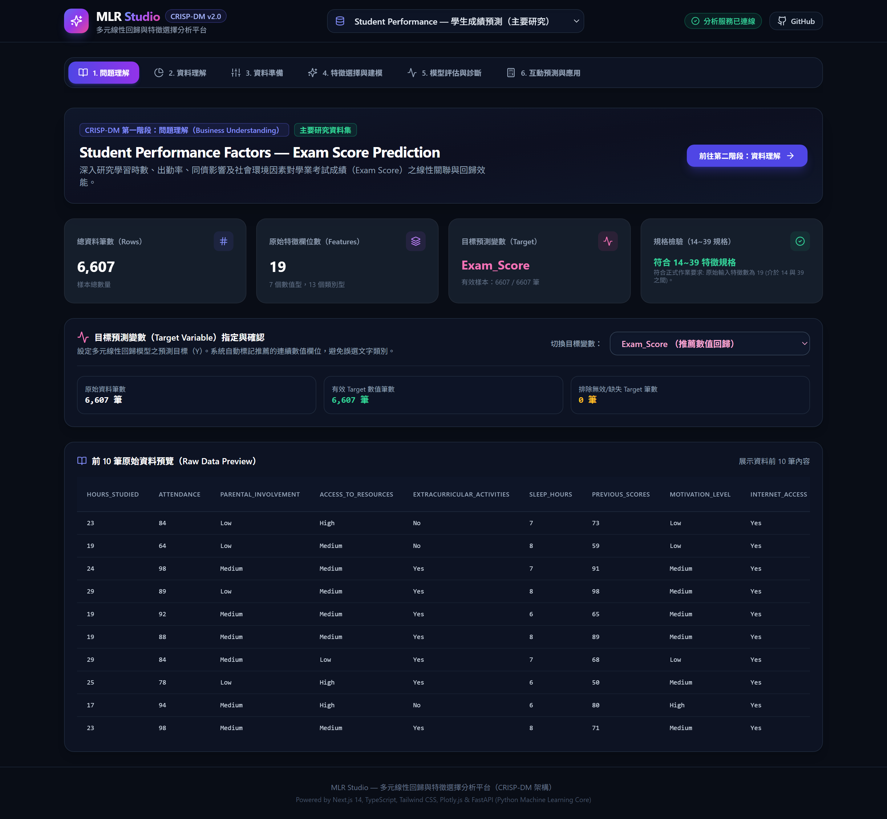
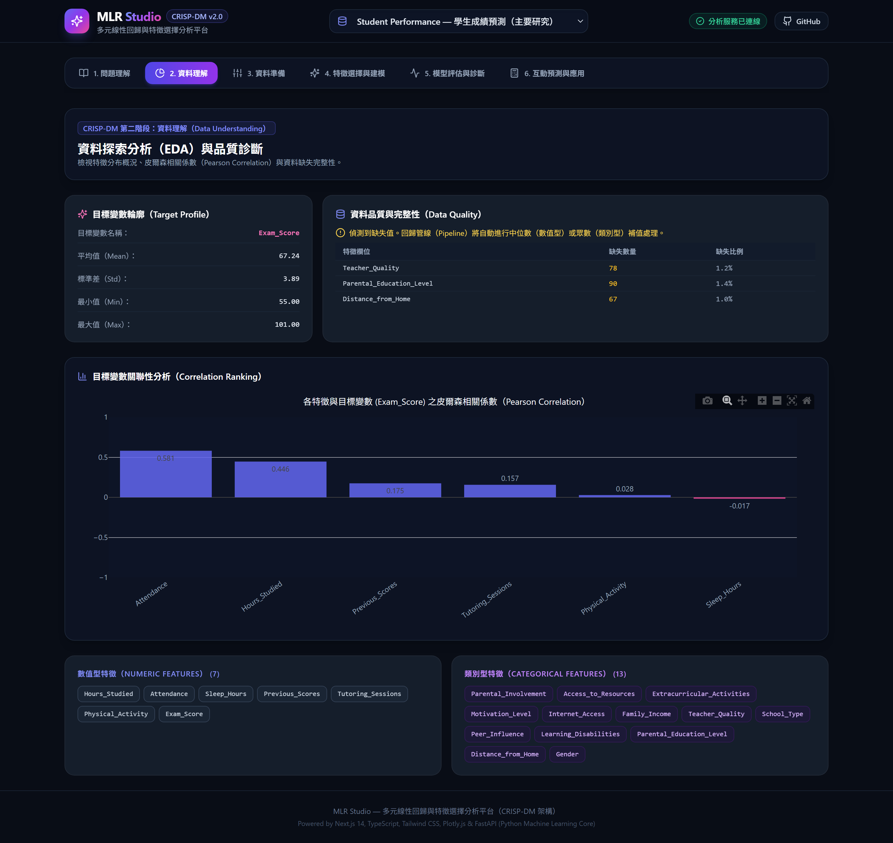
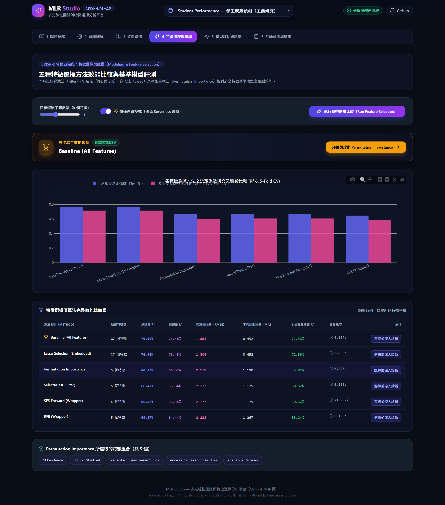
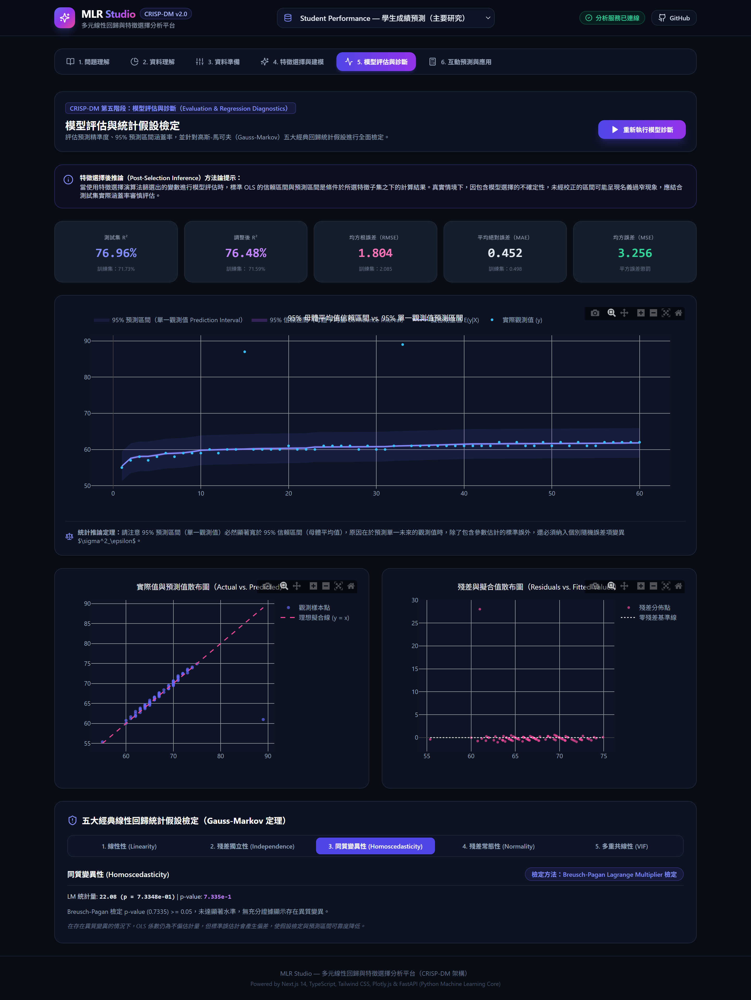
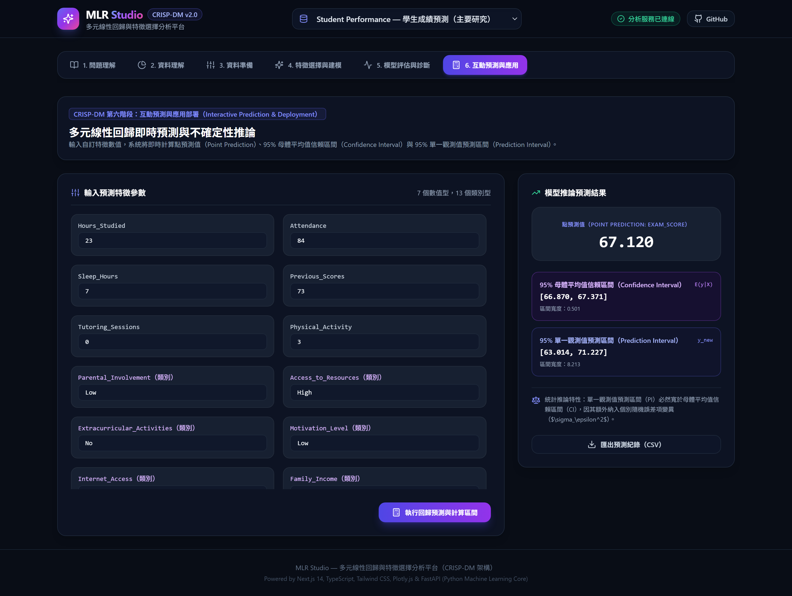
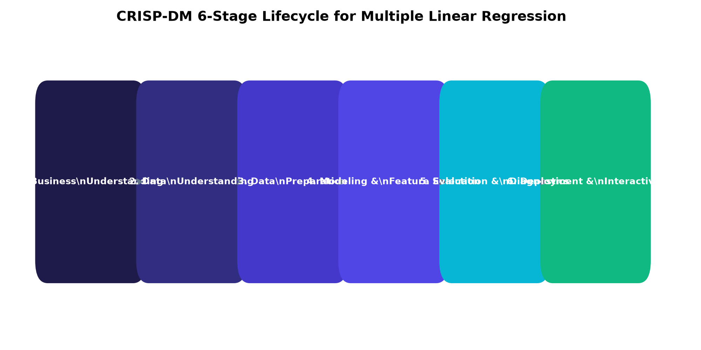
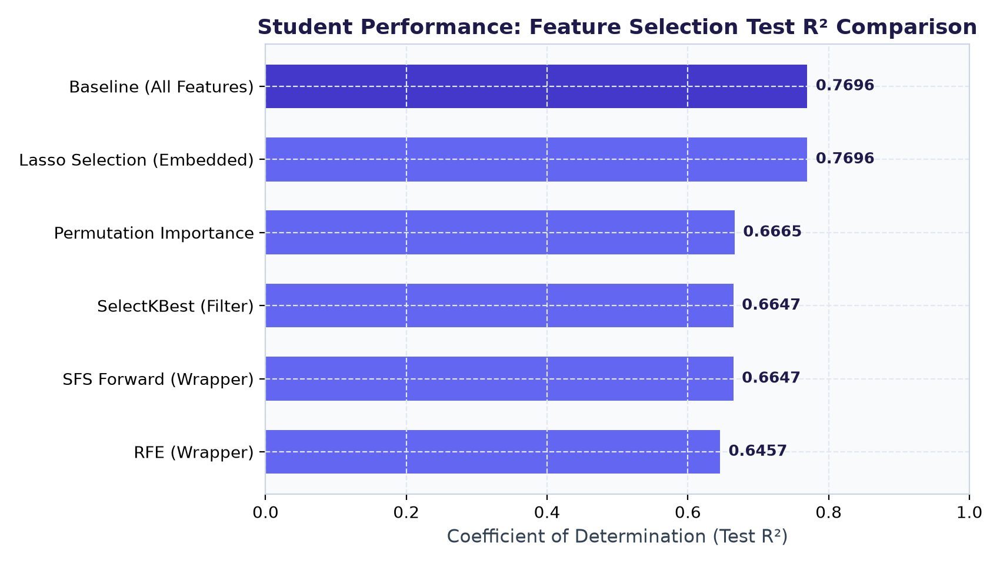
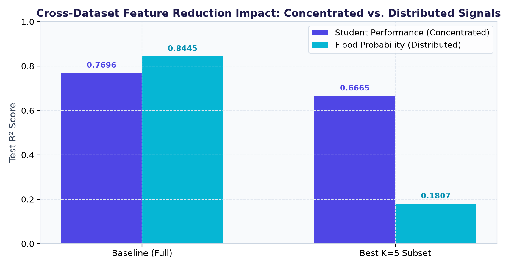

# Multiple Linear Regression Dashboard
### Interactive Regression Analysis with CRISP-DM and Feature Selection

[](https://www.python.org/)
[](https://nextjs.org/)
[](https://fastapi.tiangolo.com/)
[](docs/deployment.md)
[](tests/)
[](LICENSE)

> **GitHub Repository**：https://github.com/sam052003/Multiple-Linear-regression  
> **核心設計文件 (Single Source of Truth)**：[MyPlan/design.md](MyPlan/design.md)  
> **作業繳交檢查清單 (Submission Checklist)**：[docs/submission_checklist.md](docs/submission_checklist.md)  

---

## 🚀 Live Demo

- **Vercel 專案穩定網域（Production Domain）**：https://multiple-linear-regression-zeta.vercel.app/
  - **可訪問性實測說明**：此網域為 Vercel 專案設定之公開穩定網域（免登入可直接開啟首頁，HTTP `200`）。由於目前最新繁體中文介面與獨立報告分離架構位於 `migration/vercel` 分支，合併前依作業規範暫不執行 Production Deployment，因此該穩定網域目前仍停留在初始部署版本（`/api/health` 將於 `migration/vercel` 合併至 `main` 觸發正式部署後自動更新為 `200 OK`）。
- **`migration/vercel` 最新預覽部署（Preview Deployment）**：https://multiple-linear-regression-6vvr46i3k-cwa-weather-project.vercel.app/
  - **可訪問性實測說明**：部署狀態為 `● Ready`，經 Vercel CLI 實測後端 `/api/health` 回傳 `200 OK`（`v2.0.0`）；惟受 Vercel 團隊預設 Deployment Protection（Standard Protection）保護，未登入團隊帳號之外部瀏覽器開啟時會導向 Vercel SSO 驗證（HTTP `302`）。待 Pull Request 合併至 `main`（或於 Vercel Project Settings 關閉 Deployment Protection）後即可完全免登入公開體驗。

---

## 🖼️ Screenshots（實際系統執行畫面）

以下畫面均擷取自實際運行之 **Next.js 14 App Router + FastAPI** 互動分析平台（截圖說明詳見 [assets/screenshots/README.md](assets/screenshots/README.md)）：

### 1. 問題理解與資料集規格檢驗（Stage 1: Overview）


### 2. 資料理解與探索性分析（Stage 2: Data Understanding & EDA）


### 3. 五種特徵選擇演算法與基準模型完整比較（Stage 4: Feature Selection）


### 4. 模型評估、95% CI/PI 帶狀圖與高斯-馬可夫假設診斷（Stage 5: Evaluation & Diagnostics）


### 5. 即時單筆預測、95% 信賴／預測區間與 CSV 匯出（Stage 6: Interactive Prediction）


### 6. 自訂資料集載入模組（本機 CSV 上傳與公開 HTTPS SSRF 防護）


---

## ✨ Key Features（核心功能摘要）

- **CRISP-DM 六階段全流程互動平台**：涵蓋「問題理解 → 資料理解 → 資料準備 → 特徵選擇與建模 → 模型評估與診斷 → 互動預測與應用」，全站採用臺灣繁體中文（`zh-Hant-TW`）並保留標準機器學習英文術語。
- **三組內建主題與自訂 CSV 雙軌支援**：內建 `50 Startups`（教學展示）、`Student Performance`（主要研究，19 個原始特徵，符合 14~39 特徵規格）、`Flood Probability`（對照研究，20 個水文特徵），並支援本機 CSV 上傳（4.5 MB／5,000 筆上限）與具逐跳 SSRF 防護之公開 HTTPS CSV 網址載入。
- **六組特徵選擇平行評測**：於無資料洩漏之訓練集管線上同步比較 `Baseline (All Features)`、`SelectKBest (Filter)`、`RFE (Wrapper)`、`SFS Forward (Wrapper)`、`LassoCV (Embedded)` 與 `Permutation Importance`。
- **嚴謹計量診斷與 95% CI / PI 區間推論**：整合 `Statsmodels OLS` 計算母體均值 **95% 信賴區間（CI）** 與個別新觀測值 **95% 預測區間（PI）**，並提供線性性、Durbin-Watson、Breusch-Pagan、Jarque-Bera／Q-Q 圖及 VIF 共線性檢定。
- **公開網站與獨立研究報告嚴格分離**：正式學術報告、NotebookLM 研究心得與實驗 Notebook 僅保存於 GitHub Repository，公開網站與公開 API 均不暴露報告下載端點（`/api/reports/*` 驗證回傳 `404`）。

---

## 📊 Research Results（核心研究結果摘要）

本研究以 **Student Performance**（`N = 6,607`，19 個原始特徵／One-Hot 後 27 個編碼特徵）為主要研究對象，並以 **Flood Probability**（`N = 30,000`，20 個數值特徵）進行跨資料集訊號分布對照（80/20 訓練測試切分，`random_state = 42`）：

| 資料集 | 模型／特徵選擇方法 | 選取特徵數 | 測試集 R² | 測試集 RMSE | 測試集 MAE | 5 折 CV 平均 R² |
| :--- | :--- | :---: | :---: | :---: | :---: | :---: |
| **Student Performance** | **Baseline (All Features)** | 27 | **0.769650** | **1.804445** | 0.452392 | 0.715640 |
| **Student Performance** | **LassoCV (Embedded, α = 0.002271)** | 27 | **0.769650** | **1.804445** | 0.452392 | 0.715640 |
| **Student Performance** | **Permutation Importance（最佳 K=5）** | 5 | **0.666460** | **2.171314** | 1.190198 | 0.598229 |
| **Student Performance** | SelectKBest / SFS Forward (K=5) | 5 | 0.664693 | 2.177060 | 1.174921 | 0.606198 |
| **Student Performance** | RFE (Wrapper, K=5) | 5 | 0.645730 | 2.237773 | 1.266664 | 0.581398 |
| **Flood Probability** | **Baseline / LassoCV** | 20 | **0.844545** | **0.019983** | 0.015939 | 0.844880 |
| **Flood Probability** | **RFE（最佳 K=5）** | 5 | **0.180733** | **0.045873** | 0.036778 | 0.175343 |

- **關鍵實證發現**：
  1. **特徵縮減與訊號分布結構**：`Student Performance` 屬於少數核心變數主導之集中型訊號，縮減至 5 個特徵仍保留約 **86.6%** 的測試集解釋力（`R²: 0.769650 → 0.666460`）；反之 `Flood Probability` 屬於 20 個特徵均勻貢獻之分散型訊號，強制縮減至 `K = 5` 會引發嚴重遺漏變數偏差（`R²: 0.844545 → 0.180733`）。
  2. **LassoCV 自適應懲罰特性**：在大樣本下交叉驗證選出極小懲罰係數（`α = 0.002271`），L1 正則化以最小化 CV MSE 為目標保留全部非零貢獻特徵，並不保證固定篩選為 5 個特徵。
  3. **95% CI 與 95% PI 實證差異**：於 Student 測試集上，95% 母體均值信賴區間（CI）平均寬度為 `0.5913` 分（測試集個體落入率 `49.85%`），而 95% 個別觀測值預測區間（PI）平均寬度為 `8.2190` 分（測試集個體涵蓋率達 `99.47%`），驗證預測個別新樣本必須納入個體誤差變異。

---

## 📌 Project Deliverables（專案成果架構）

本專案成果明確分為兩大部分：
1. **互動式網頁分析平台（Interactive Web Dashboard）**：
   - 全站採用臺灣繁體中文（`zh-Hant-TW`）介面，保留重要英文機器學習術語。
   - 遵循 CRISP-DM 六大步驟之互動分析流程：問題理解、資料理解、資料準備、特徵選擇與建模、模型評估與診斷、互動預測與應用。
   - 支援 3 大內建回歸主題（50 Startups、Student Performance、Flood Probability）與自訂 CSV（HTTPS 網址／本機上傳）。
   - 提供 5 大特徵選擇演算法平行比較、高斯-馬可夫回歸五大假設統計診斷、Statsmodels 95% 預測區間推論與預測紀錄 CSV 匯出。
   - 部署於 Vercel 雲端無伺服器架構（Next.js 14 + FastAPI）。
2. **獨立 CRISP-DM 研究報告（Independent Research Report）**：
   - 正式學術報告為獨立作業繳交文件，完全與互動網站分離，不於公開網站中提供展示或下載入口，公開 API 亦不暴露報告內容。
   - 報告資產由離線腳本與 Notebook 獨立維護，完整保留於 Repository 根目錄下之 `reports/`、`notebooks/` 與 `scripts/` 中。



---

## 📚 Documentation Links（文件、報告與研究圖表索引）

### 研究報告與實驗資產（GitHub Repository 檔案索引）
- 📄 **正式研究報告（PDF，13 頁出版排版）**：[reports/final_report.pdf](reports/final_report.pdf)
- 📝 **正式研究報告（Markdown 原始碼）**：[reports/final_report.md](reports/final_report.md)
- 🧠 **Google NotebookLM 實際研究心得與參考文獻**：[reports/notebooklm_summary.md](reports/notebooklm_summary.md)
- 📓 **主要研究實驗 Notebook（Student Performance）**：[notebooks/student_performance_analysis.ipynb](notebooks/student_performance_analysis.ipynb)
- 📓 **對照研究實驗 Notebook（Flood Probability）**：[notebooks/flood_prediction_analysis.ipynb](notebooks/flood_prediction_analysis.ipynb)
- 📈 **研究統計圖表目錄（共 7 張高解析度 PNG）**：[reports/figures/](reports/figures/)
  1. [reports/figures/crisp_dm_process.png](reports/figures/crisp_dm_process.png) — CRISP-DM 六階段研究流程圖
  2. [reports/figures/feature_selection_comparison.png](reports/figures/feature_selection_comparison.png) — 六種特徵選擇方法效能比較圖
  3. [reports/figures/actual_vs_predicted.png](reports/figures/actual_vs_predicted.png) — 實際值 vs. 預測值散佈圖
  4. [reports/figures/residuals_vs_fitted.png](reports/figures/residuals_vs_fitted.png) — 殘差 vs. 擬合值散佈圖
  5. [reports/figures/residuals_distribution_qq.png](reports/figures/residuals_distribution_qq.png) — 殘差直方圖與常態 Q-Q 圖
  6. [reports/figures/student_pi_intervals.png](reports/figures/student_pi_intervals.png) — 95% CI vs. 95% PI 區間帶狀比較圖
  7. [reports/figures/student_vs_flood_comparison.png](reports/figures/student_vs_flood_comparison.png) — Student vs. Flood 跨資料集特徵縮減對照圖
- 📊 **離線實驗數據 CSV 目錄**：[reports/results/](reports/results/)
  - [reports/results/student_feature_selection_comparison.csv](reports/results/student_feature_selection_comparison.csv)
  - [reports/results/flood_feature_selection_comparison.csv](reports/results/flood_feature_selection_comparison.csv)
  - [reports/results/student_predictions_intervals.csv](reports/results/student_predictions_intervals.csv)
- 💬 **AI 開發對話紀錄存放區（ChatGPT PDF 待使用者匯入）**：[reports/ai_conversations/](reports/ai_conversations/)

### 技術文件與操作指南
- ✅ **作業繳交檢查清單**：[docs/submission_checklist.md](docs/submission_checklist.md)
- 📐 **系統設計與架構紀錄（Single Source of Truth）**：[MyPlan/design.md](MyPlan/design.md)
- ☁️ **Vercel 雲端部署與資源規範指南**：[docs/deployment.md](docs/deployment.md)
- 🔬 **CRISP-DM 與統計方法論說明**：[docs/methodology.md](docs/methodology.md)
- 📖 **Google NotebookLM 文獻研究整合說明**：[docs/notebooklm_research_guide.md](docs/notebooklm_research_guide.md)
- 🖨️ **ChatGPT 對話紀錄匯出 PDF 指南**：[docs/chatgpt_conversation_export_guide.md](docs/chatgpt_conversation_export_guide.md)
- 🖼️ **系統截圖與圖表說明**：[assets/screenshots/README.md](assets/screenshots/README.md)

---

## 🌟 網站核心功能詳解 (Interactive Web Dashboard Details)

### 1. 臺灣繁體中文介面 (Traditional Chinese Localization)
- 網站所有導航、標題、說明文字、統計指標、假設檢定解說、圖表標籤與錯誤提示均採自然、專業的臺灣繁體中文。
- 同步保留重要機器學習英文術語（如：多元線性回歸 Multiple Linear Regression、特徵選擇 Feature Selection、資料探索分析 EDA、平均絕對誤差 MAE、均方根誤差 RMSE、決定係數 R²、95% 預測區間 Prediction Interval、95% 信賴區間 Confidence Interval 等）。

### 2. 三個內建回歸主題切換 (Problem Selector)
網站頂端下拉選單提供三個經典與進階 Regression Problems：
- 🏢 **50 Startups — 新創公司利潤預測**（**預設教學展示案例**）：經典入門案例，分析研發、行政、行銷支出與所在州別對企業淨利之影響。
- 🎓 **Student Performance — 學生成績預測**（**主要研究**）：Kaggle 教育基準資料，共 6,607 筆資料、**19 個原始輸入特徵**（精確符合 14~39 個特徵作業規格），Target 為連續數值 `Exam_Score`。
- 🌊 **Flood Probability — 洪水機率預測**（**比較研究**）：Kaggle 高維度環境觀測合成資料集，20 個數值特徵，採用固定種子抽樣 30,000 筆快取，嚴格排除 `id` 欄位。

### 3. 自由自訂資料集支援 (Custom Dataset)
完整支援使用者載入任意回歸資料集：
- 🌐 **安全 CSV URL 載入**：內建逐跳 SSRF 防護機制，強制 HTTPS、DNS 解析檢查、嚴格阻擋本機與內部私有 IP、檔案下載 4.5MB 限制與逾時保護。
- 💻 **本機 CSV 上傳**：支援直接上傳本機 CSV 並自動進行資料型態判斷與前處理（上限 5,000 筆，不進行靜默截斷）。
- 🎯 **自訂 Target 與特徵過濾**：使用者可自由指定 Target，自動辨識數值與類別特徵，排除 ID 欄位，並對 14~39 特徵規格與連續數值 Target 有效性給出動態檢驗。

### 4. 五大特徵選擇演算法深度比較 (Feature Selection Suite)
支援從全特徵 Baseline 到五大方法全面平行比較（固定在 Training Set 上擬合）：
1. **Baseline**：保留全部前處理後特徵。
2. **SelectKBest**：Filter 方法，以 `f_regression` F 檢定評分。
3. **Recursive Feature Elimination (RFE)**：Wrapper 方法，以 `LinearRegression` 遞迴剃除權重最小特徵。
4. **Sequential Feature Selector (SFS)**：Wrapper 方法，以貪婪前向搜尋 (`forward`) 尋找最佳 CV MSE 子集，支援大資料集 Fast Mode。
5. **Lasso Feature Selection**：Embedded 方法，使用 `LassoCV` 正則化進行特徵收縮，具備非零權重保底機制。
6. **Permutation Importance**：Model-based 方法，於內部驗證集打亂特徵值評估泛化性能衰退量。

### 5. 95% 預測區間推論 (95% Prediction Interval)
依作業要求完整呈現預測不確定性，透過 **Statsmodels OLS** 實作：
- **95% Confidence Interval for Mean (母體均值信賴區間)**：評估給定條件下平均期望值的落點 $E(y|X)$。
- **95% Prediction Interval for Observation (單一觀測值預測區間)**：評估新觀測值的落點，納入個體隨機誤差 $\sigma^2_\epsilon$，區間必定寬於 CI。
- 揭露特徵選擇後之 Post-selection inference 統計限制與警示。

### 6. 多元線性回歸五大假設診斷 (Regression Diagnostics)
- **線性性 (Linearity)**：殘差 vs. 擬合值散佈圖與零軸正交檢定。
- **殘差獨立性 (Independence)**：Durbin-Watson 統計量（附帶橫斷面資料適用限制說明）。
- **同質變異性 (Homoscedasticity)**：Breusch-Pagan 檢定與 p-value 解讀。
- **殘差常態性 (Normality)**：Q-Q 圖、Jarque-Bera 檢定與大樣本敏感度說明。
- **多重共線性 (Multicollinearity)**：相關係數分析與變異數膨脹因子 (VIF) 計算表。

---

## 📊 實驗結果圖表預覽 (Feature Selection Visual Summary)





---

## 📂 專案架構 (Project Structure)

```text
HW2-Multiple Linear regression/
├── app/                              # Next.js 14 App Router (Frontend, 臺灣繁體中文)
│   ├── layout.tsx                    # 根佈局 (zh-Hant-TW) 與深色主題設定
│   ├── page.tsx                      # 儀表板主入口與 CRISP-DM 六大階段管理器
│   ├── globals.css                   # Tailwind 指令與玻璃擬態樣式
│   ├── types/api.ts                  # 前後端共用 TypeScript 型別
│   ├── lib/api.ts                    # REST API 客戶端
│   └── components/                   # React 現代化元件
│       ├── Navbar.tsx                # 導航列、Problem Selector 與連線狀態
│       ├── CustomDatasetModal.tsx    # 自訂資料集載入視窗 (SSRF 防護)
│       ├── PlotlyChart.tsx           # Plotly.js 客戶端動態圖表
│       └── tabs/                     # CRISP-DM 六大階段分頁
│           ├── OverviewTab.tsx       # Stage 1: 問題理解與資料集摘要
│           ├── DataUnderstandingTab.tsx # Stage 2: 資料理解 EDA 與相關分析
│           ├── DataPreparationTab.tsx   # Stage 3: 資料準備管線與基準模型
│           ├── FeatureSelectionTab.tsx  # Stage 4: 特徵選擇與建模評測
│           ├── EvaluationTab.tsx     # Stage 5: 模型評估與統計假設診斷
│           └── PredictionTab.tsx     # Stage 6: 互動預測與單筆推論
├── api/                              # FastAPI Backend (Vercel Serverless)
│   ├── index.py                      # ASGI 應用進入點 (報告路由已取消掛載)
│   ├── schemas.py                    # Pydantic v2 Request/Response Contracts
│   ├── requirements.txt              # Vercel Serverless 專屬相依套件
│   ├── services/ml_service.py        # 無狀態機器學習服務層
│   └── routers/                      # REST API 路由
│       ├── datasets.py               # 資料集概覽與自訂資料解析
│       ├── analysis.py               # 模型訓練、特徵選擇與診斷
│       └── predict.py                # 單筆樣本 95% PI 推論
├── assets/screenshots/               # 6 張 Next.js 實際系統畫面截圖與說明
├── notebooks/                        # 真實執行完畢之實驗分析 Jupyter Notebooks
│   ├── student_performance_analysis.ipynb
│   └── flood_prediction_analysis.ipynb
├── reports/                          # [獨立成果] 正式研究報告與實驗數據 (不公開於網站)
│   ├── final_report.md               # 論文形式正式報告 Markdown
│   ├── final_report.pdf              # 論文形式正式報告 PDF (13 頁)
│   ├── notebooklm_summary.md         # Google NotebookLM 實際文獻研究心得與書目
│   ├── figures/                      # 7 張高解析度靜態研究圖表
│   ├── results/                      # 實驗預測與特徵比較 CSV
│   └── ai_conversations/             # ChatGPT 開發對話 PDF 存放區 (待使用者匯入)
├── docs/                             # 部署、方法論、NotebookLM 與繳交檢查清單
├── src/                              # Python Machine Learning 核心演算法
│   ├── config.py                     # 全域常數與資料集詮釋資料
│   ├── data_loader.py                # 資料讀取與記憶體快取 (@lru_cache)
│   ├── data_validation.py            # SSRF 防護、格式驗證與資料品質報告
│   ├── preprocessing.py              # ColumnTransformer 管線 (防資料洩漏)
│   ├── feature_selection.py          # 5 大特徵選擇演算法與比較引擎
│   ├── modeling.py                   # 線性回歸與係數解析
│   ├── evaluation.py                 # MAE, RMSE, R2, Adjusted R2 與 CV
│   ├── statistical_tests.py          # 5 大回歸假設統計檢定與 VIF
│   ├── prediction_intervals.py       # Statsmodels OLS 95% PI / CI 推論
│   ├── visualization.py              # 靜態論文圖表生成模組
│   └── reporting.py                  # [離線用] 純函式動態報告與 PDF 產出
├── vercel.json                       # Vercel Monorepo 路由設定
├── package.json                      # Next.js 前端相依套件與腳本
├── requirements.txt                  # Python 完整相依套件清單
├── tests/                            # 自動化測試套件 (pytest, 57 項全數通過)
│   ├── test_api.py                   # FastAPI REST API 整合測試 (含報告端點 404 檢驗)
│   ├── test_data_loader.py           # 資料載入測試
│   ├── test_custom_dataset.py        # SSRF 防護與資料檢核測試
│   ├── test_custom_dataset_regression.py # 自訂資料集 Target 驗證與樣本一致性迴歸測試
│   ├── test_modeling.py              # 線性回歸訓練與指標測試
│   ├── test_feature_selection.py     # 5 大特徵選擇演算法測試
│   ├── test_prediction_intervals.py  # 95% PI 與假設檢定測試
│   └── test_reporting_consistency.py # 離線報告一致性、NotebookLM 整合與無副作用驗證
└── app.py                            # [Legacy] 原 Streamlit 進入點 (保留)
```

---

## 💻 本機執行指南 (Local Execution)

### 1. 環境需求
- Python 3.11+ / 3.12 / 3.14
- Node.js 18+ (推薦 v20 LTS)
- Git

### 2. 安裝步驟
```bash
# 複製儲存庫
git clone https://github.com/sam052003/Multiple-Linear-regression.git
cd Multiple-Linear-regression

# 安裝 Python 相依套件
pip install -r requirements.txt

# 安裝前端 Node.js 相依套件
npm install
```

### 3. 執行自動化測試 (57 項全數通過)
```bash
pytest tests/ -v
```

### 4. 啟動開發伺服器

#### 終端機 1：啟動 FastAPI 後端 (Port 8000)
```powershell
python -m uvicorn api.index:app --reload --port 8000
```
- API 文件：`http://127.0.0.1:8000/api/docs`

#### 終端機 2：啟動 Next.js 前端 (Port 3000)
```powershell
npm run dev
```
- 瀏覽器開啟：`http://localhost:3000`

---

## 🌐 Vercel 雲端部署 (Vercel Deployment)

本專案支援一鍵部署至 **Vercel**：
1. 進入 [Vercel Dashboard](https://vercel.com/dashboard) 並連結 GitHub。
2. 匯入 Repository：`sam052003/Multiple-Linear-regression`。
3. Framework Preset 保持為 `Next.js`，Root Directory 保持為 `./`。
4. 點選 **Deploy**，Vercel 將自動編譯 Next.js 前端並以 Serverless Function 架設 `api/index.py`。
> 詳細步驟與資源限制說明請參閱 [docs/deployment.md](docs/deployment.md)。

---

## 🤖 AI 輔助開發揭露 (AI Assistance Disclosure)

- **工具**：ChatGPT、Google NotebookLM、Google Antigravity
- **輔助範疇**：CRISP-DM 架構規劃、Next.js 14 + FastAPI 遷移、SSRF 網址安全防護設計、Statsmodels OLS 與 Scikit-learn 特徵矩陣對齊、自動化測試撰寫與報告模組整合。
- **ChatGPT 對話 PDF 匯出（待使用者匯入）**：請依據 [docs/chatgpt_conversation_export_guide.md](docs/chatgpt_conversation_export_guide.md) 將真實 ChatGPT 完整對話匯出為 PDF 並放置於 [reports/ai_conversations/](reports/ai_conversations/)（目前保留存放目錄，不虛構假對話）。
- **NotebookLM 文獻研究（已完成）**：真實研讀心得與 6 項參考來源已永久整合至 [reports/notebooklm_summary.md](reports/notebooklm_summary.md) 與 [reports/final_report.pdf](reports/final_report.pdf) 第 9.1 節／第 10 節（說明見 [docs/notebooklm_research_guide.md](docs/notebooklm_research_guide.md)）。
