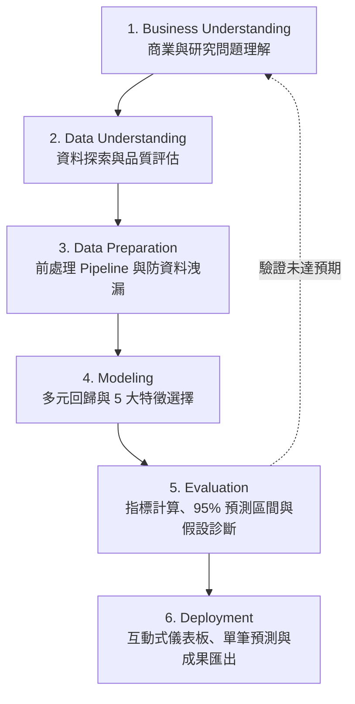

# 多元線性回歸與特徵選擇方法論手冊 (Methodology Guide)

> **專案名稱**：Multiple Linear Regression Dashboard  
> **核心主題**：CRISP-DM 流程、五大特徵選擇、Statsmodels OLS 統計推論與 95% 預測區間  

---

## 1. CRISP-DM 六大階段方法論架構

---

## 2. 多元線性回歸數學基礎 (Mathematical Formulation)

### 2.1 矩陣形式
給定訓練樣本資料矩陣 $\mathbf{X} \in \mathbb{R}^{n \times (p+1)}$（含截距常數項）與目標向量 $\mathbf{y} \in \mathbb{R}^{n}$，多元線性回歸模型假設：
$$\mathbf{y} = \mathbf{X}\boldsymbol{\beta} + \boldsymbol{\epsilon}, \quad \boldsymbol{\epsilon} \sim \mathcal{N}(\mathbf{0}, \sigma^2 \mathbf{I})$$

### 2.2 最小平方法 (Ordinary Least Squares, OLS)
透過最小化殘差平方和 (Sum of Squared Residuals, SSR)：
$$S(\boldsymbol{\beta}) = (\mathbf{y} - \mathbf{X}\boldsymbol{\beta})^T (\mathbf{y} - \mathbf{X}\boldsymbol{\beta})$$
當設計矩陣 $\mathbf{X}$ 具備行滿秩 (Full Column Rank) 時，閉式解 (Closed-form Solution) 為：
$$\hat{\boldsymbol{\beta}} = (\mathbf{X}^T \mathbf{X})^{-1} \mathbf{X}^T \mathbf{y}$$

---

## 3. 五大特徵選擇演算法深度比較

| 方法 (Method) | 演算法類型 | 核心選取準則 | 計算複雜度 | 優點 | 限制 |
|---|---|---|---|---|---|
| **SelectKBest** | Filter (過濾法) | $F = \frac{MS_{reg}}{MS_{error}}$ (單變量顯著性) | $\mathcal{O}(p \cdot n)$ 極低 | 計算速度極快，適合超高維資料初步降維 | 忽略特徵間相互共線與組合綜效 |
| **RFE** | Wrapper (包裝法) | 逐步剃除 $|\beta_j|$ 權重最小特徵 | $\mathcal{O}((p - k) \cdot \text{Cost}_{fit})$ 中等 | 考慮模型全體回歸權重排序 | 每次僅剃除一個特徵，無法重新評估已剔除者 |
| **SFS Forward** | Wrapper (包裝法) | 貪婪由空逐步加入使 CV MSE 下降最多者 | $\mathcal{O}(k \cdot p \cdot \text{Cost}_{cv})$ 較高 | 直接以最終交叉驗證分數為導向 | 特徵數多時計算負擔極大，需 Fast Mode |
| **Lasso Selection** | Embedded (嵌入法) | $\min \frac{1}{2n}\|\mathbf{y} - \mathbf{X}\boldsymbol{\beta}\|_2^2 + \alpha \|\boldsymbol{\beta}\|_1$ | 凸優化中等 | 正則化同時實現特徵挑選與防過擬合 | 若高度共線會隨機選取其中一個，其餘壓為 0 |
| **Permutation Importance** | Model-based | 隨機打亂驗證集特徵值，評估評估分數衰減量 | $\mathcal{O}(B \cdot p \cdot \text{Cost}_{eval})$ 中等 | 直接度量特徵對非訓練集之真實泛化貢獻 | 需獨立驗證集，計算依賴模型預測次數 |

---

## 4. 95% 信賴區間 vs 95% 預測區間推論公式

給定新特徵向量 $\mathbf{x}_0$：
1. **點預測值**：$\hat{y}_0 = \mathbf{x}_0^T \hat{\boldsymbol{\beta}}$
2. **95% Confidence Interval for Mean (母體均值信賴區間)**：
   $$\hat{y}_0 \pm t_{n-p-1, 1-\alpha/2} \cdot s \cdot \sqrt{\mathbf{x}_0^T (\mathbf{X}^T \mathbf{X})^{-1} \mathbf{x}_0}$$
   > 估計相同特徵下，所有可能樣本之「平均反應」落在該範圍之機率。
3. **95% Prediction Interval for Observation (單一觀測值預測區間)**：
   $$\hat{y}_0 \pm t_{n-p-1, 1-\alpha/2} \cdot s \cdot \sqrt{1 + \mathbf{x}_0^T (\mathbf{X}^T \mathbf{X})^{-1} \mathbf{x}_0}$$
   > 估計「單一新個體觀測值」落入之範圍。由於包含個別擾動項變異（根號內多出 $+1$），**預測區間 (PI) 範圍必定明顯大於信賴區間 (CI)**。

---

## 5. 線性回歸五大假設診斷原理
1. **線性性 (Linearity)**：
   - 檢驗殘差 $\mathbf{e} = \mathbf{y} - \hat{\mathbf{y}}$ 與擬合值 $\hat{\mathbf{y}}$ 是否存在非線性模式。
2. **殘差獨立性 (Independence)**：
   - Durbin-Watson 統計量 $DW = \frac{\sum_{t=2}^n (e_t - e_{t-1})^2}{\sum_{t=1}^n e_t^2}$。注意橫斷面資料缺乏自然時序之適用限制。
3. **同質變異性 (Homoscedasticity)**：
   - Breusch-Pagan 檢定：以輔助回歸檢驗殘差平方是否可被自變數預測。
4. **殘差常態性 (Normality)**：
   - Jarque-Bera 統計量基於偏度 (Skewness) 與峰度 (Kurtosis)。大樣本下檢定過度敏感，須以分佈對稱性為主。
5. **多重共線性 (Multicollinearity)**：
   - 變異數膨脹因子 $VIF_j = \frac{1}{1 - R_j^2}$，衡量第 $j$ 個特徵被其餘特徵線性預測之程度。$VIF > 5 \sim 10$ 表高度共線。
